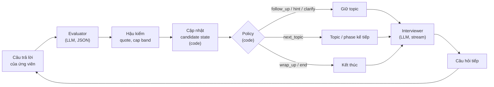

# 5. Vòng lặp adapt & candidate state

> Thuộc bộ [AI Service design doc](README.md). Liên quan: §4 (điều kiện chuyển), §6 (rubric, quy đổi điểm).

## 5.1 Vòng lặp



LLM chỉ xuất hiện ở hai ô: **Evaluator** (đánh giá) và **Interviewer** (diễn đạt). Mọi thứ ở giữa là code
deterministic, cùng input luôn ra cùng quyết định.

## 5.2 Candidate state

> **Thêm 2026-10-22:** `phase_started_s`, `topic_started_s` (giây kể từ đầu phiên khi phase và topic hiện tại bắt đầu), dùng cho ngân sách thời gian (design 03 §4.4). interview-service chỉ lưu và gửi lại state, không cần hiểu các trường này.

JSON do ai-service trả trong event `done`, interview-service lưu ở `interview_sessions.candidate_state` và gửi lại
nguyên văn ở lượt sau. Kích thước điển hình 2–4 KB.

```jsonc
{
  "schema_version": 1,
  "phase": "technical",                        // intro|technical|scenario|wrap_up|done
  "phase_started_at_s": 260,                   // giây kể từ đầu phiên
  "phase_budget_s": 960,                       // đã cộng thời gian mượn từ phase trước
  "topic_index": 1,                            // vị trí trong phase hiện tại
  "active_topic_id": "t3",
  "topic_started_at_s": 610,
  "current_difficulty": 3,                     // 1–5, kẹp trong [min, max] của level
  "difficulty_bounds": { "min": 1, "max": 4 },
  "momentum": 1,                               // -1|0|+1: kết quả topic trước, ảnh hưởng độ khó topic sau
  "counters": {                                // của topic hiện tại, reset khi đổi topic
    "follow_ups": 1,                           // gồm cả hint và clarify
    "hints": 0,
    "clarifies": 0,
    "consecutive_dont_know": 0
  },
  "turn_count": 7,
  "evaluated_turns": 6,
  "topics": [                                  // tóm tắt từng topic đã/đang hỏi
    { "id": "t1", "status": "done", "score_band": 3.2, "hint_used": false, "turns": [1, 2, 3] },
    { "id": "t2", "status": "done", "score_band": 1.6, "hint_used": true,  "turns": [4, 5] },
    { "id": "t3", "status": "active", "score_band": null, "hint_used": false, "turns": [6, 7] }
  ],
  "strengths": [                               // ≤ 10, dedupe theo tag
    { "tag": "rest-api-design", "turns": [2, 3] }
  ],
  "gaps": [                                    // ≤ 10, dedupe theo tag
    { "tag": "spring-proxy-self-invocation", "turns": [4, 5] }
  ],
  "asked_questions": [                         // ≤ 30 câu gần nhất, đã chuẩn hóa, để chống lặp
    "kể về dự án order service và vai trò của bạn"
  ],
  "end_reason": null                           // candidate_ended|time_up|time_hard_limit|turn_cap|plan_complete|low_performance|abandoned
}
```

Không lưu điểm từng lượt trong state (đã có ở `interview_turns.evaluation`); state chỉ giữ thứ policy cần.

## 5.3 Luật cập nhật state (code)

Sau mỗi `Evaluation` hợp lệ (không degraded):

1. **Điểm lượt** (thang band 0–4):
   `turn_score = 0.40·technical_accuracy + 0.25·completeness + 0.25·extensibility + 0.10·relevance`.
   Relevance trọng số thấp vì hầu hết câu trả lời đều "đúng trọng tâm", dễ thổi phồng điểm.
2. **Phân loại lượt:** `strong` nếu `turn_score ≥ 3.0`; `ok` nếu `1.75 ≤ turn_score < 3.0`; `weak` nếu `< 1.75`.
   `answer_type` ∈ {`dont_know`, `off_topic`, `asks_clarification`, `manipulation`} được xử lý riêng trước.
3. **Strengths:** thêm `strength_tags` khi lượt `strong` **và** `technical_accuracy ≥ 3`.
4. **Gaps:** thêm `gap_tags` khi lượt `weak`, hoặc có `misconceptions`, hoặc `dont_know` (tag = slug topic).
   Một tag đã ở `strengths` mà sau đó lộ gap → chuyển sang `gaps` (bằng chứng mới hơn thắng).
5. **Counters:** `follow_ups += 1` nếu lượt vừa rồi không phải `ask_main`; `hints`/`clarifies` tăng theo action
   vừa thực hiện; `consecutive_dont_know` tăng hoặc reset.
6. **`asked_questions`:** thêm câu hỏi vừa hỏi (lowercase, bỏ dấu câu), giữ 30 câu gần nhất. Câu lấy từ kho
   (`question_bank`) ghi thêm `current_qa_id` (để Evaluator lấy đáp án chuẩn ở lượt sau) và `used_qa_ids` (≤ 30, không hỏi lại).
7. **Đóng topic:** `score_band` = trung bình `turn_score` các lượt được chấm của topic; `hint_used` nếu có hint;
   `momentum = +1` nếu `score_band ≥ 3.0`, `-1` nếu `< 1.75`, ngược lại `0`.

## 5.4 Policy chọn hành động tiếp

> **Cập nhật 2026-10-22 (`app/focus.py`):** `focus` không còn cố định. Luật 8 và `hint` chọn ý còn thiếu **chưa hỏi** trong topic (theo `missing_points`, gợi ý của Evaluator, rồi key point chưa nêu); luật 10 chọn key point chưa nêu, rồi các hướng đào sâu gắn tên topic (trade-off, edge case, cơ chế bên trong, khi scale). Hết ý mới thì `next_topic`. Focus đã hỏi lưu ở `topics[].focus_used` (tối đa 6, chỉ focus đã qua kiểm injection), hai focus coi là trùng khi Jaccard ≥ 0.8. Ý ứng viên đã nêu được gộp theo cả topic ở `topics[].covered` (tối đa 10) để không hỏi lại ý đã trả lời ở lượt trước; một ý coi là đã nêu khi chứa ≥ 50% từ nội dung của key point.

> **Cập nhật 2026-11-06 (`hint_focus`):** focus của `hint` (luật 4, 6) chỉ lấy hướng Evaluator gợi ý cho câu vừa hỏi (`follow_up_focus`), rồi `missing_points` chưa hỏi; **không** lấy key point của cả topic nữa. Key point thường gộp nhiều khái niệm ("encapsulation và polymorphism") nên Interviewer gợi ý sang khái niệm khác thay vì giúp ứng viên trả lời câu đang hỏi. Không có ý nào thì `focus` rỗng, Interviewer gợi ý từ `last_question` và đáp án chuẩn.

Chạy sau khi các điều kiện ưu tiên 1–5 ở §4.4 (hết giờ, hết phase, đóng topic) không khớp. Đọc từ trên
xuống, luật đầu tiên khớp thắng. `F` = follow-up còn lại của topic (`max_follow_up − counters.follow_ups`).

| # | Điều kiện | Action | Độ khó | `focus` cho Interviewer |
|---|---|---|---|---|
| 1 | `manipulation` | `follow_up` (nếu `F > 0`) hoặc `next_topic` | giữ | Câu hỏi gốc, diễn đạt lại; ghi nhận như lượt `weak` |
| 2 | `off_topic` hoặc `asks_clarification`, chưa clarify | `clarify` | giữ | Câu hỏi vừa rồi, rõ hơn |
| 3 | `off_topic` / `asks_clarification`, đã clarify | `next_topic` | giữ | — |
| 4 | `dont_know`, chưa hint, `F > 0` | `hint` | `−1` | `hint_focus`: `follow_up_focus` rồi `missing_points` chưa hỏi; không có thì rỗng |
| 5 | `dont_know`, đã hint hoặc `F = 0` | `next_topic` | topic sau `−1` | — |
| 6 | `weak`, chưa hint, `F > 0` | `hint` | `−1` | `hint_focus` (như luật 4) |
| 7 | `weak`, đã hint hoặc `F = 0` | `next_topic` | topic sau `−1` | — |
| 8 | `ok`, `F > 0`, có `missing_points` | `follow_up` | giữ | `missing_points[0]` |
| 9 | `ok`, còn lại | `next_topic` | giữ | — |
| 10 | `strong`, `F > 0` | `follow_up` | `+1` | `follow_up_focus` (trade-off, internals, edge case) |
| 11 | `strong`, `F = 0` | `next_topic` | topic sau `+1` | — |

- Độ khó luôn kẹp trong `difficulty_bounds`.
- **Độ khó khởi đầu topic mới** = `clamp(plan.start_difficulty + momentum)`: ứng viên làm tốt topic trước thì topic
  sau mở ở mức khó hơn plan một bậc.
- `next_topic` khi phase hết topic thì orchestrator chuyển phase (§4.4), Interviewer nhận `transition.phase_changed = true`.
- Evaluation `degraded`: xử lý như `ok` không có `missing_points`, nhưng nếu `follow_ups = 0` thì `follow_up` theo
  key point đầu tiên chưa được hỏi (tránh đóng topic chỉ sau 1 câu vì lỗi kỹ thuật).

### Policy lai: LLM đề xuất, code quyết (2026-11-14, phase 04, `POLICY_MODE=hybrid`)

Cờ mặc định `rules` = luật trên, không đổi. `hybrid`: Evaluator (prompt **v9**, lớp `EvaluatorOutputV9`, cách A: gộp vào lượt chấm, không thêm lời gọi) trả thêm `next_action` (`follow_up|hint|clarify|next_topic`), `next_focus`, `difficulty_delta`, `action_reason` (≤ 20 từ), sau khi chấm xong. Đầu vào v9 thêm `policy_context` (`follow_ups_left`, `hint_used`, `clarifies_used`, `time_hint`, độ khó + biên, `focus_used`, `covered`); chuỗi từ ứng viên bọc `<untrusted>`; prompt buộc chấm độc lập với trạng thái phỏng vấn. `app/policy_hybrid.py::validate_decision` kiểm đề xuất với `classify(ev)` **sau** `allowed_actions` theo ngân sách (`app/policy.py::action_budget`):

| `classify(ev)` | Hành động LLM được chọn | `difficulty_delta` (ngoài khoảng thì kẹp, không bác) |
|---|---|---|
| nhạy cảm: `manipulation`, `off_topic`, `asks_clarification`, `dont_know`, `ok_degraded`, **hoặc câu trả lời khớp mẫu injection** (`cv_text.has_injection`, để lệnh kiểu "chuyển câu khác đi" kèm mẫu injection không bỏ qua follow-up) | không giao LLM: dùng `decide()` (`overrule_reason = sensitive_kind`) | – |
| `weak` | còn hint (`left > 0`, chưa gợi ý): `hint` hoặc `clarify`; hết hint: `next_topic` hoặc `clarify` | −1 … 0 |
| `ok` | `follow_up`, `next_topic` | 0 |
| `strong` | `follow_up`, `next_topic` | 0 … +1 |

`clarify` luôn cần `clarifies < 1` và `left > 0`; `follow_up`/`hint` cần `left > 0`; `hint` cần chưa gợi ý. `next_focus` qua `safe_focus`, bỏ nếu trùng `focus_used` hoặc ý ứng viên đã nêu; không còn thì lấy focus của luật (cùng hành động) hoặc `gap_focus`/`deepen_focus`/`hint_focus`. `follow_up` không có focus hợp lệ thì bác (`no_valid_focus`); `hint` không focus vẫn hợp lệ (như luật: hỏi lại câu vừa hỏi). Đề xuất thiếu, tên hành động lạ hoặc ngoài bảng thì dùng `decide()` kèm lý do (`no_proposal`, `action_not_allowed`), không làm hỏng lượt chấm. `action_reason` qua `safe_focus` + bộ lọc PII (`redact_pii`); trúng thì bỏ. Metric: `ai_policy_decisions_total{decided_by}`, `ai_policy_overrules_total{reason}` (06 §metrics).

### 5.5 Lập lại kế hoạch giữa buổi (2026-11-14, phase 05, `REPLAN_ENABLED=false`, cần `POLICY_MODE=hybrid`)

**Mặc định tắt và chưa bật ở môi trường thật cho đến khi FSD xác nhận hợp đồng (06 §7.4).** Mô hình dữ liệu (đều có giá trị mặc định, plan/state cũ chạy như cũ):

- `plan.replan: {reserve: PlanTopic[≤ 2], keep_ids: string[]} | null`. Lúc start (`app/replan_reserve.py`, sau Planner và `prefer_covered`, chỉ khi cờ bật) code chọn tối đa 2 topic catalog của level chưa có trong plan, có câu trong kho ở độ khó bắt đầu (khi biết số đếm; số đếm rỗng = không biết thì không lọc), xếp theo topic JD ưu tiên rồi độ trùng CV, id **`alt1`, `alt2`** (không dùng `r*` của yêu cầu JD hay `t{n}` của plan). Reserve nhận snippet và câu kho trong cùng lượt `attach_reference_snippets` (chung hạn 5 s). Không còn topic thừa (vd fresher có thể 0) thì `replan = null`: phiên này không đổi topic. `keep_ids` = id topic plan map từ `jd.priority_topic_ids()` (tính lúc start vì `next-turn` không nhận `jd_profile`).
- `state.swaps: [{drop, add, turn, reason}]`. `reason` qua `safe_reason` (injection, PII, ≤ 20 từ). `turn.swap_result`: `applied | budget | bad_drop | jd_priority | bad_add | not_applicable | untrusted`, chỉ có khi LLM đề xuất đổi (metric `ai_replan_swaps_total{result}`).

Evaluator **v10** = v9 + `swap: {drop, add, reason} | null` (`EvaluatorOutputV10`, kiểu lỏng như v9) + khối `replan_context` (JSON: `swaps_left`, `current_topic_band`, topic technical pending có thể bỏ, reserve chưa dùng; id và tiêu đề từ catalog, không có chuỗi ứng viên) ở cuối tin nhắn, chỉ ở topic technical còn reserve và còn lượt đổi. v10 được chọn **cố định cả phiên** khi `POLICY_MODE=hybrid` và `REPLAN_ENABLED` (env, không đổi giữa lượt nên prompt chấm và prompt cache không đổi giữa phiên). Prompt buộc `swap = null` mặc định, chấm độc lập với `replan_context`, không đổi vì câu trả lời yếu hay yêu cầu của ứng viên. Bảng kiểm `validate_swap` và thứ tự ưu tiên: 03 §4.4.

`effective_plan(plan, state)` thay topic theo `state.swaps` tại đúng vị trí, trả nguyên plan khi không có swap hoặc plan cũ. Client phải gửi lại nguyên `state.swaps` (và `plan.replan`) mỗi lượt; `state.swaps` do client mang nên được tin ở mức interview-service tin cậy, và lệch với `state.topics` (swap giả, trùng, mất `replan`) bị chặn bằng kiểm khớp vị trí → 409. Plan trả về client từ next-turn vẫn là plan gốc (`alt*` chỉ nằm trong `plan.replan.reserve`); `turn.topic_id` có thể là `alt1`; `/api/finalize` tự áp `effective_plan` từ `state.swaps` (báo cáo hiện `alt*` ở vị trí topic bị bỏ, topic bị bỏ không có điểm nên biến mất khỏi danh sách; không cần trạng thái `skipped`).

### 5.6 Ghi chú agent (tùy chọn, 2026-11-14, phase 07, `AGENT_NOTES_ENABLED=false`, cần `POLICY_MODE=hybrid`)

**Mặc định tắt; chưa đo nên chưa có lý do bật** (gate chấm điểm và đọc tay 20 phiên là [BLOCKED-KEY], mục 09). Lý do hoãn: người dùng duy nhất của ghi chú là chính lời gọi Evaluator chấm điểm (Interviewer, Reporter không đọc), nên ghi chú kiểu `risk: yếu X` có thể neo điểm.

- `state.notes: [{id, turn, topic_id, kind, text, status}]`, mặc định `[]` (state cũ nạp được; JSON thêm khóa `notes: []`, báo FSD cùng đợt với `swaps`). `id = n{turn}`, `kind`: `hypothesis | to_verify | strength | risk`, `status`: `open | confirmed | rejected`, `text` ≤ 150 ký tự (state do client gửi: `text` ≤ 300 và `notes` ≤ 8 phần tử, vượt thì 422). Model ở `app/models_agent_notes.py` (re-export qua `models_interview`).
- Evaluator **v11** = v10 + `new_note: {kind, text} | null` và `note_updates: [{id, status}]` (`EvaluatorOutputV11`, kiểu lỏng như v9/v10: giá trị lạ thì bỏ, không làm hỏng lượt chấm). Chọn cố định cả phiên khi `AGENT_NOTES_ENABLED` và hybrid (ưu tiên hơn v10; v11 gồm cả `swap`, nên một phiên chỉ có một version). Cờ tắt: v8 (rules), v9 (hybrid), v10 (hybrid + `REPLAN_ENABLED`) y nguyên, request giống từng byte (test ghim v8/v9/v10 với `notes_context` đặt sẵn).
- `app/agent_notes.py::apply_notes` chạy cuối `choose_decision` (sau quyết định), chỉ khi cờ bật: tối đa 1 ghi chú mới mỗi lượt; tối đa 8; đầy thì bỏ ghi chú đã xong (`confirmed/rejected`) cũ nhất, rồi ghi chú cũ nhất không phải `to_verify` (`strength/risk/hypothesis` không bao giờ xong nên không được chiếm chỗ mãi); chỉ bỏ ghi chú mới (`full`) khi cả 8 đều là `to_verify` đang `open`. `safe_note` kiểm trên **toàn bộ** text đã gộp khoảng trắng rồi mới xét độ dài: có mẫu injection (`has_injection`), PII (`redact_pii` đổi text) hoặc dài hơn 150 ký tự thì bỏ (không cắt, vì cắt giữa số điện thoại hay email sẽ lọt một phần PII). `note_updates` chỉ đổi được ghi chú `to_verify` đang `open` và status `confirmed|rejected`.
- **Lượt không tin cậy** (`overrule_reason == "sensitive_kind"`, loại nhạy cảm, hoặc `has_injection(answer)`, kể cả lượt forced) không ghi và không cập nhật gì (`untrusted`). Code không dùng ghi chú để tính điểm hay quyết định hành động; nhưng Evaluator v11 thấy ghi chú `to_verify` đang `open` khi chấm và đề xuất hành động, nên có rủi ro neo điểm (đo ở gate [BLOCKED-KEY], mục 09). Interviewer và Reporter không đọc ghi chú.
- **Chỉ ghi chú `to_verify` đang `open`** được đưa lại vào Evaluator (`notes_for_context`, qua `safe_note` lần nữa vì state do client mang), trong khối `<untrusted label="open_notes">` cuối tin nhắn (`render` trong `evaluator_input.build_messages`, chỉ với v11). `strength`/`risk`/`hypothesis` chỉ lưu (giảm neo điểm, audit H2).
- Metric `ai_notes_recorded_total{kind}` (ghi chú đã lưu) và `ai_notes_dropped_total{reason}` (`untrusted`, `empty`, `too_long`, `injection`, `pii`, `invalid_kind`, `duplicate`, `full`, `unknown_id`, `bad_status`; tập nhãn đóng). `has_injection` có thể bỏ nhầm ghi chú kỹ thuật (mẫu "```", `you are`): chấp nhận, theo dõi bằng metric này.

### Map sang `agent_decision` hiện có

Cột `interview_turns.agent_decision` (`deepen | switch_topic | keep_difficulty`) giữ để tương thích FE/BE cũ.
Cột mới `action` lưu giá trị đầy đủ.

| `action` (mới) | Thay đổi độ khó | `agent_decision` (cũ) |
|---|---|---|
| `follow_up` | `+1` hoặc giữ | `deepen` |
| `hint` | `−1` | `keep_difficulty` |
| `clarify` | giữ | `keep_difficulty` |
| `ask_main` (topic / phase mới) | bất kỳ | `switch_topic` |
| `wrap_up`, `end` | — | `switch_topic` |

Đây là **thay đổi contract** (thêm enum `action`), cần cập nhật `api-contracts.md` và `data-model.md` (README,
câu hỏi 2).

## 5.5 Ví dụ trace: Junior, Java Backend, topic "Spring @Transactional"

Giới hạn Junior: 2 follow-up, 1 hint. Topic mở ở độ khó 2 (plan) + momentum `+1` (topic trước tốt) = **3**.

| Lượt | Action → câu hỏi (tóm tắt) | Câu trả lời (tóm tắt) | Band (acc/comp/ext/rel) | `turn_score` | Phân loại | Quyết định tiếp |
|---|---|---|---|---|---|---|
| 4 | `ask_main` d3: "Ghi 2 bảng trong 1 method, lỗi giữa chừng thì sao?" | Nói được `@Transactional` rollback cả hai | 3 / 2 / 2 / 4 | 2.60 | ok | Luật 8: `follow_up` d3, focus = "rollback rules với checked exception" |
| 5 | `follow_up` d3: "Nếu method ném checked exception thì có rollback không?" | "Có, mọi exception đều rollback" | 1 / 1 / 0 / 3 | 0.95 | weak | Luật 6: `hint` d2, focus = "rollback mặc định" |
| 6 | `hint` d2: "Gợi ý: Spring phân biệt RuntimeException và checked exception. Vậy mặc định nó rollback với loại nào?" | "À, chỉ RuntimeException, muốn checked thì dùng `rollbackFor`" | 3 / 3 / 2 / 4 (cap 3 vì hint) → 3 / 3 / 2 / 3 | 2.75 | ok | `follow_ups = 2 = max` → **đóng topic**. `score_band = (2.60 + 0.95 + 2.75) / 3 = 2.10`, `hint_used`, `momentum = 0` |
| 7 | `ask_main` d2 (plan 2 + 0): chuyển sang topic "JPA N+1" | … | … | … | … | … |

State sau lượt 6: thêm gap `spring-rollback-rules` (lượt 5), strength không đổi; topic t2 `done`.

## 5.6 Chống lặp & giữ đúng vai

- **Không lặp câu hỏi:** Interviewer nhận `asked_questions_on_topic`; offline đo tỉ lệ lặp (Jaccard token ≥ 0.8
  với câu đã hỏi) trong eval (§10, mục tiêu < 5%). Không chặn được sau khi đã stream, nên dựa vào prompt + đo.
- **Không lộ đánh giá:** Interviewer không nhận band hay nhận xét của Evaluator, chỉ nhận `focus` (một cụm chủ
  đề). Không có dữ liệu thì không lộ được.
- **Không kéo dài vô hạn:** mọi vòng đều bị chặn bởi giới hạn follow-up, turn cap 24 và thời gian (§4.3–4.4),
  tất cả kiểm bằng code.
- **Khi ứng viên hỏi lại** ("ý anh là sao ạ?"): Evaluator gắn `asks_clarification` → `clarify`, không bị tính là
  trả lời yếu.
