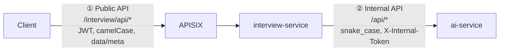

# 7. API contract

> Thuộc bộ [AI Service design doc](README.md). Liên quan: §4 (luồng xử lý), §6.4 (report), §8 (lưu trữ).

## 7.1 Hai tầng API



| | ① Public API | ② Internal API |
|---|---|---|
| Server | interview-service (NestJS) | ai-service (FastAPI) |
| Caller | Client (Next.js) qua APISIX | Chỉ interview-service, trong Docker network |
| Auth | JWT qua APISIX, role `Candidate`, chỉ chủ phiên | Header `X-Internal-Token` (env `AI_SERVICE_INTERNAL_TOKEN`) |
| Format | `{ data, meta }`, lỗi `{ statusCode, message, errorCode, details }` (`docs/conventions.md`) | JSON snake_case, lỗi `{ error, message, details }` (giữ như ai-integration.md) |
| Streaming | SSE (relay) | SSE (nguồn) |

**Bảo mật:** route APISIX `/ai/*` hiện **public, không JWT** (ai-integration.md §6). Khi ai-service gọi LLM thật,
ai cũng có thể gọi thẳng và đốt quota. Đề xuất: APISIX chỉ expose `/ai/api/health`; mọi endpoint khác chỉ gọi từ
Docker network và yêu cầu `X-Internal-Token`.

## 7.2 Public API (interview-service)

Base URL: `/interview/api`. So với `api-contracts.md` §3.4 hiện tại: `POST /sessions` **không còn trả câu hỏi
đầu** (tách sang `/start` để gắn CV trước), `/answer` chuyển sang stream. Đây là thay đổi contract với FSD.

| Method | Path | Mô tả | Response |
|---|---|---|---|
| POST | `/sessions` | Tạo phiên (track, level, thời lượng) | 201 JSON |
| POST | `/sessions/:id/cv` | Gắn CV đã nộp ở job-service (không upload) | 200 JSON |
| POST | `/sessions/:id/start` | Planner + câu hỏi đầu | **SSE** |
| POST | `/sessions/:id/answer` | Gửi câu trả lời, nhận câu hỏi tiếp | **SSE** |
| GET | `/sessions/:id` | Trạng thái, tiến độ, câu hỏi hiện tại (để resume) | 200 JSON |
| POST | `/sessions/:id/end` | Kết thúc sớm / kích hoạt tạo report | 202 JSON |
| GET | `/sessions/:id/report` | Lấy report | 200 JSON / 202 khi đang tạo |
| POST | `/sessions/:id/report/regenerate` | Tạo lại report (khi `partial` / `report_failed`) | 202 JSON |
| DELETE | `/sessions/:id` | Xóa phiên và toàn bộ dữ liệu (transcript, cv_profile, report) | 204 |
| GET | `/sessions` | Danh sách phiên của tôi (giữ như hiện tại, thêm `track`, `level`) | 200 JSON |

### POST /sessions

```http
POST /interview/api/sessions
Authorization: Bearer <JWT>
Content-Type: application/json

{ "track": "java_backend", "level": "junior", "durationMinutes": 30 }
```

```jsonc
// 201 Created
{
  "data": {
    "id": "0192f3a1-7c2e-7b10-9a55-3c1d2e4f5a6b",
    "status": "created",
    "track": "java_backend",
    "level": "junior",
    "category": "Backend",
    "difficulty": "easy",
    "durationMinutes": 30,
    "cvStatus": "none",
    "createdAt": "2026-11-10T09:00:00.000Z"
  }
}
```

Quota: tối đa 5 phiên / ứng viên / ngày (env `INTERVIEW_DAILY_QUOTA`), vượt thì 429 `QUOTA_EXCEEDED`.

### POST /sessions/:id/cv

Gắn CV **đã nộp ở job-service** vào phiên (không upload file, §2.3). Client lấy danh sách application kèm job
title từ `GET /job/api/applications/my` (đã có) để ứng viên chọn.

```http
POST /interview/api/sessions/0192f3a1-.../cv
Content-Type: application/json

{ "cvApplicationId": "0192e0aa-5b1c-7d22-8f10-aa11bb22cc33", "consent": true }
```

`cvApplicationId` bỏ trống thì dùng CV của application mới nhất. Kết quả parse được dùng lại nếu CV đã parse ở
phiên trước (cùng `objectKey + etag`), khi đó response trả gần như ngay.

```jsonc
// 200 OK — trả bản tóm tắt để ứng viên kiểm tra hệ thống hiểu đúng CV
{
  "data": {
    "cvStatus": "parsed",
    "profileSummary": {
      "headline": "Backend developer ~2 năm, Java/Spring Boot",
      "skills": ["Java", "Spring Boot", "PostgreSQL", "Kafka", "Redis"],
      "projects": [{ "id": "p1", "name": "Order service" }],
      "totalYearsExperience": 2.5,
      "trackRelevance": "high",
      "truncated": false
    }
  }
}
```

`cvStatus`: `none | parsed | failed`. Lỗi: `CV_NOT_FOUND` (404), `CV_TOO_LARGE` (413), `CV_INVALID_FORMAT` (415),
`CV_UNREADABLE` (422), `SESSION_INVALID_STATE` (409), `CV_SOURCE_UNAVAILABLE` (503). CV Parser lỗi sau retry: 200 với
`cvStatus = "failed"` (phiên vẫn chạy được).

### POST /sessions/:id/start (SSE)

```http
POST /interview/api/sessions/0192f3a1-.../start
Accept: text/event-stream
```

```text
HTTP/1.1 200 OK
Content-Type: text/event-stream
Cache-Control: no-cache
X-Accel-Buffering: no

event: meta
data: {"turnNumber":1,"phase":"intro","topicIndex":1,"topicTotal":6,"action":"ask_main","remainingSeconds":1800}

event: token
data: {"t":"Chào bạn, mình bắt đầu nhé. "}

event: token
data: {"t":"Trong CV bạn có nhắc tới order service dùng Kafka"}

event: token
data: {"t":" — bạn kể giúp mình phần việc chính của bạn trong dự án đó?"}

event: done
data: {"turnNumber":1,"question":"Chào bạn, mình bắt đầu nhé. Trong CV bạn có nhắc tới order service dùng Kafka — bạn kể giúp mình phần việc chính của bạn trong dự án đó?","sessionStatus":"in_progress","remainingSeconds":1796}
```

Planner mất vài giây trước event `meta`; interview-service gửi comment `: ping` mỗi 5 s trong lúc chờ để proxy
không cắt kết nối. Lỗi: `SESSION_INVALID_STATE` (đã start), `AI_SERVICE_ERROR`.

### POST /sessions/:id/answer (SSE)

```http
POST /interview/api/sessions/0192f3a1-.../answer
Content-Type: application/json
Accept: text/event-stream

{ "turnNumber": 4, "answer": "Em đặt @Transactional ở service layer, nếu lỗi giữa chừng thì cả hai bảng đều rollback ạ." }
```

- `turnNumber` = lượt **đang trả lời** (chống gửi trùng, §4.6). Đã xử lý → stream lại câu hỏi đã lưu ngay (1
  event `token` + `done`); đang xử lý → 409 `TURN_CONFLICT`; lệch → 409 `TURN_CONFLICT`.
- `answer`: 1–4000 ký tự sau trim (cho phép câu ngắn như "Em không biết"; contract cũ yêu cầu ≥ 10 ký tự).

```text
event: meta
data: {"turnNumber":5,"phase":"technical","topicIndex":1,"topicTotal":6,"action":"follow_up","remainingSeconds":1190}

event: token
data: {"t":"Ok, vậy nếu method đó ném ra một checked exception"}

event: token
data: {"t":" thì transaction có rollback không?"}

event: done
data: {"turnNumber":5,"question":"Ok, vậy nếu method đó ném ra một checked exception thì transaction có rollback không?","sessionStatus":"in_progress","remainingSeconds":1186}
```

Event **không chứa điểm hay nhận xét** (§6.5). `action` dùng để client hiển thị nhẹ (ví dụ nhãn "Gợi ý" khi
`hint`), có thể bỏ qua.

**Lượt cuối:** sau khi ứng viên trả lời câu wrap-up (hoặc hết giờ cứng), stream chỉ có `done`:

```text
event: done
data: {"turnNumber":15,"question":null,"sessionStatus":"reporting","remainingSeconds":0}
```

**Các event khác:**

```text
event: replace
data: {"question":"<câu hỏi dự phòng đầy đủ>"}            // Interviewer lỗi giữa stream: client thay toàn bộ câu hỏi

event: error
data: {"errorCode":"AI_SERVICE_ERROR","message":"AI tạm thời không phản hồi","retryable":true}
```

`error` với `retryable = true`: lượt chưa được ghi nhận, client cho gửi lại cùng `turnNumber`.

*(Cài đặt 2026-10-22, ai-service.)* `replace` cũng được gửi khi câu Interviewer vừa stream bị code từ chối (lặp câu đã hỏi, lộ điểm hoặc đáp án, quá dài) hoặc đã được bỏ markdown. `done.question` luôn là câu cuối cùng (sau `replace` nếu có); `turn.question_source` là `ai` hoặc `fallback`. interview-service lưu `done.question`, không ghép lại từ các `token`.

### GET /sessions/:id

```jsonc
// 200 OK — dùng khi refresh trang / mất kết nối giữa stream
{
  "data": {
    "id": "0192f3a1-...",
    "status": "in_progress",
    "track": "java_backend",
    "level": "junior",
    "cvStatus": "parsed",
    "progress": { "phase": "technical", "topicIndex": 1, "topicTotal": 6, "turnCount": 5, "remainingSeconds": 1150 },
    "currentQuestion": { "turnNumber": 5, "questionText": "Ok, vậy nếu method đó ném ra một checked exception thì transaction có rollback không?" },
    "turns": [
      { "turnNumber": 1, "questionText": "...", "candidateAnswer": "..." }
    ],
    "startedAt": "2026-11-10T09:01:00.000Z",
    "completedAt": null
  }
}
```

`turns` không chứa điểm khi phiên chưa `completed`.

### POST /sessions/:id/end

```jsonc
// 202 Accepted
{ "data": { "sessionStatus": "reporting" } }
```

interview-service gọi `/api/finalize` **bất đồng bộ** (promise trong process, timeout 90 s, ghi kết quả vào DB).
Khi khởi động, service quét các phiên kẹt ở `reporting` quá 5 phút và chạy lại. Không cần message queue.

### GET /sessions/:id/report

```jsonc
// 202 Accepted — đang tạo
{ "data": { "status": "reporting", "retryAfterSeconds": 3 } }
```

```jsonc
// 200 OK — report đầy đủ theo schema §6.4 (camelCase ở public API)
{
  "data": {
    "status": "complete",
    "overall": { "score": 5.7, "verdict": "near", "summary": "..." },
    "sections": [{ "phase": "intro", "score": 7.0, "weight": 0.15 }],
    "criteria": { "technicalAccuracy": 5.5, "completeness": 5.0, "extensibility": 4.5, "relevance": 8.0 },
    "topics": [], "strengths": [], "improvements": [], "studyPlan": [], "turns": [],
    "meta": { "confidence": "high", "disclaimer": "Điểm do AI chấm, mang tính tham khảo cho việc luyện tập." }
  }
}
```

### Mã lỗi

| `errorCode` | HTTP | Khi nào |
|---|---|---|
| `SESSION_NOT_FOUND` | 404 | (đã có) |
| `SESSION_NOT_YOURS` | 403 | (đã có) |
| `SESSION_COMPLETED` | 409 | (đã có) gửi answer khi phiên đã xong |
| `AI_SERVICE_ERROR` | 503 | (đã có) ai-service lỗi / timeout sau retry |
| `SESSION_INVALID_STATE` | 409 | Gắn CV sau start, start 2 lần, answer trước start |
| `TURN_CONFLICT` | 409 | `turnNumber` lệch hoặc đang xử lý |
| `CV_NOT_FOUND` | 404 | Application không tồn tại / không thuộc ứng viên / không có CV; ứng viên chưa ứng tuyển lần nào |
| `CV_SOURCE_UNAVAILABLE` | 503 | job-service hoặc object storage không phản hồi |
| `CV_TOO_LARGE` | 413 | > 10 MB hoặc > 10 trang |
| `CV_INVALID_FORMAT` | 415 | Sai magic bytes, PDF mã hóa, DOCX hỏng |
| `CV_UNREADABLE` | 422 | Trích xuất < 200 ký tự (ảnh scan) |
| `QUOTA_EXCEEDED` | 429 | Vượt số phiên / ngày |
| `VALIDATION_ERROR` | 400 | (đã có) field sai, thiếu consent, answer rỗng / > 4000 ký tự |

## 7.3 TCP pattern mới: interview-service → job-service

Theo ADR-003 (NestJS ↔ NestJS qua TCP). job-service (FSD) implement, thêm vào `api-contracts.md` §2.

```typescript
// @MessagePattern('application.getCvFile')
interface GetCvFileRequest {
  candidateId: string;           // từ x-auth-user, interview-service truyền xuống
  applicationId?: string;        // bỏ trống = application mới nhất có CV
}

interface GetCvFileResponse {
  applicationId: string;
  objectKey: string;             // key trong bucket CV
  etag: string;                  // đổi khi file đổi → dùng làm cv_file_ref cùng objectKey
  contentType: string;           // application/pdf | application/vnd.openxmlformats-officedocument.wordprocessingml.document
  size: number;                  // byte
  downloadUrl: string;           // presigned GET, TTL 5 phút
}

// Lỗi: RpcException { errorCode: 'CV_NOT_FOUND' } khi application không tồn tại,
// không thuộc candidateId, hoặc không có CV.
```

job-service **bắt buộc** kiểm `application.candidate_id = candidateId`; interview-service không tự kiểm được vì
không đọc `job_db`. Presigned URL phải ký với endpoint storage mà interview-service truy cập được (trong Docker
network là host nội bộ của MinIO; khi deploy là endpoint S3).

## 7.4 Internal API (ai-service)

Giữ tên `start / next-turn / finalize` theo constitution IV; **nội dung** đổi theo thiết kế này. Thêm `cv/parse` và `jd/parse` (A11).

| Method | Path | Agent chạy | Response | Timeout phía interview-service |
|---|---|---|---|---|
| POST | `/api/cv/parse` | CV Parser | JSON | 30 s |
| POST | `/api/jd/parse` | JD Parser | JSON | 30 s |
| POST | `/api/start` | Planner → Interviewer | SSE | 40 s (event đầu ≤ 25 s) |
| POST | `/api/next-turn` | Evaluator → policy → Interviewer | SSE | 45 s (event đầu ≤ 15 s) |
| POST | `/api/finalize` | (code tính điểm) → Reporter | JSON | 90 s |
| GET | `/api/health` | — | JSON | 5 s |
| GET | `/api/stt/phrases` | — (code) | JSON | 5 s |
| GET | `/metrics` | — (code) | text Prometheus | 5 s |

**`GET /metrics` (2026-11-05, `app/metrics.py`, NFR-AI-OBS03):** số liệu Prometheus cho Grafana. Cần `X-Internal-Token` như các endpoint khác. Prometheus scrape thẳng `ai-service:8000` trong network nội bộ, không qua APISIX: gateway chỉ mở `/ai/api/health`. Không có nội dung hay `session_id`; nhãn chỉ là mã có ít giá trị.

| Metric | Nhãn | Ý nghĩa |
|---|---|---|
| `ai_requests_total` | `endpoint` (start, next_turn, finalize, cv_parse, jd_parse), `status` (ok, error, cancelled), `error` (mã lỗi API như `voice_no_speech`, `session_ended`, hoặc tên lỗi; `-` khi ok) | Request AI đã xong, đếm một lần mỗi request |
| `ai_request_duration_seconds` | `endpoint` | Thời gian cả request; với SSE thì tính tới hết stream |
| `ai_ttft_seconds` | `endpoint`, `source` (`ai` Interviewer viết, `fallback` câu dự phòng / câu hỏi lại cố định) | Từ lúc nhận request tới token câu hỏi đầu tiên (start, next_turn); xem P95 theo `source="ai"` |
| `ai_agent_calls_total` | `agent`, `fallback` (`none` hoặc mã fallback) | Lần gọi agent; tỉ lệ fallback = phần `fallback != "none"` |
| `ai_agent_latency_seconds` | `agent` | Độ trễ một lần gọi LLM |
| `ai_tokens_total` | `agent`, `kind` (input, output, cached) | Token; nhân với bảng giá để ra chi phí |
| `ai_llm_tool_calls_total` | `agent` | Lần agent gọi công cụ trong vòng lặp tool calling (2026-11-14); 0 khi chưa agent nào bật |
| `ai_llm_tools_unsupported_total` | không | Lần model/provider từ chối tools + JSON strict (latch theo tiến trình; ≥ 1 lần mỗi process vì các request đang chạy song song có thể cùng đếm) |
| `ai_rag_requests_total`, `ai_rag_errors_total` | `status` / `code` | Trạng thái RAG trong `metadata.rag`, mã lỗi RAG |
| `ai_turns_total` | `answer_source` (text, voice), `outcome` (`answer_type`, `degraded`, `low_confidence`) | Kết quả chấm mỗi lượt next-turn stream xong; lượt wrap-up không chấm thì không đếm |
| `ai_http_responses_total` | `route` (mẫu route, lạ thì `other`), `code` | Mọi response, kể cả 401/422 bị chặn trước route và 500 lỗi ngoài dự kiến. SSE đếm 200 lúc gửi header; kết quả stream (lỗi, client ngắt) xem `ai_requests_total` |

Kèm số liệu process mặc định của `prometheus_client` (CPU, RAM, file mở). Dockerfile chạy một process uvicorn; chạy nhiều worker thì phải chuyển sang chế độ multiprocess. Ví dụ PromQL cho Grafana:

- TTFT P95 lượt: `histogram_quantile(0.95, sum by (le) (rate(ai_ttft_seconds_bucket{endpoint="next_turn",source="ai"}[5m])))`
- Tỉ lệ fallback Evaluator: `sum(rate(ai_agent_calls_total{agent="evaluator",fallback!="none"}[15m])) / sum(rate(ai_agent_calls_total{agent="evaluator"}[15m]))`
- Tỉ lệ lỗi: `sum by (endpoint) (rate(ai_requests_total{status="error"}[5m])) / sum by (endpoint) (rate(ai_requests_total[5m]))`
- Token mỗi giờ theo agent: `sum by (agent, kind) (increase(ai_tokens_total[1h]))`

Ngoài contract: `GET /dev/play` là trang HTML tĩnh cho dev tự phỏng vấn thử (đóng vai interview-service, gọi các endpoint trên). Không qua token, tự trả 404 khi `APP_ENV` là staging/production; interview-service không dùng. Từ 04/11 trang có ô Giọng nói (Web Speech API của trình duyệt) gửi `answer_source`, `stt_confidence` như §7.4 để thử luồng voice; đây không phải lựa chọn nhà cung cấp STT/TTS.

### POST /api/cv/parse

Multipart: `file` (bytes interview-service đã tải từ job-service), `track`. ai-service không biết CV đến từ đâu.

```jsonc
// 200 OK
{
  "cv_profile": { "schema_version": 1, "headline": "...", "skills": [], "experiences": [], "projects": [], "education": [],
                  "total_years_experience": 2.5, "track_relevance": "high",
                  "flags": { "injection_suspected": false, "truncated": false } },
  "metadata": { "model": "openai/gpt-4o-mini", "prompt_version": "cv_parser.v1", "input_tokens": 3120, "output_tokens": 640, "latency_ms": 4100 }
}
```

```jsonc
// 422
{ "error": "cv_unreadable", "message": "Extracted text shorter than 200 characters", "details": { "chars": 37 } }
```

### POST /api/jd/parse

*(Thêm 2026-10-22, FR-AI-016, 017.)* JSON: `track`, `jd_text` (50 đến 20.000 ký tự, JD thô interview-service lấy qua TCP `application.getJobDescription`). ai-service không lưu JD; JD thô chỉ JD Parser thấy.

```jsonc
// 200 OK
{
  "jd_profile": {
    "schema_version": 1,
    "title": "Backend Developer (Java)",
    "requirements": [                                   // ≤ 15
      { "id": "r1", "text": "Thành thạo Spring Boot và DI", "kind": "must",   // must|nice
        "topic_ids": ["java.spring.ioc-di"], "out_of_catalog": false },       // topic_ids ≤ 3, chỉ id có trong catalog của track
      { "id": "r2", "text": "Kỹ năng làm việc nhóm", "kind": "must", "topic_ids": [], "out_of_catalog": true }
    ],
    "flags": { "injection_suspected": false, "truncated": false }
  },
  "metadata": { "model": "openai/gpt-4o-mini", "prompt_version": "jd_parser.v1", "input_tokens": 1800, "output_tokens": 300, "latency_ms": 3000 }
}
```

`422 invalid_request` khi `track` không có trong catalog hoặc `jd_text` ngoài giới hạn.

### POST /api/start

```jsonc
{
  "session_id": "0192f3a1-...",
  "track": "java_backend",
  "level": "junior",
  "duration_minutes": 30,
  "cv_profile": { "...": "CvProfile hoặc null" },
  "jd_profile": { "...": "JdProfile hoặc null (không có thì luyện theo track + level)" }
}
```

SSE: `meta`, `token`…, `done`. Event `done` nội bộ chứa đủ dữ liệu để interview-service lưu:

```jsonc
{
  "question": "Chào bạn, mình bắt đầu nhé. ...",
  "turn": { "turn_number": 1, "phase": "intro", "topic_id": "t1", "turn_kind": "main", "action": "ask_main",
            "agent_decision": "switch_topic", "difficulty": 2, "question_source": "ai" },
  "plan": { "...": "InterviewPlan + reference_snippets + reference_sources + bank_questions (câu hỏi từ kho, mỗi topic technical ≤ 3)" },
  "state": { "...": "candidate state §5.2" },
  "metadata": { "usage": { "planner": { "input_tokens": 2600, "output_tokens": 1400, "cached_tokens": 1792 }, "interviewer": { "input_tokens": 1200, "output_tokens": 60 } },
                "latency_ms": { "planner": 9800, "interviewer_ttft": 600, "total": 11200 },
                "prompt_versions": { "planner": "v1", "interviewer": "v1" }, "fallbacks": [],
                "rag": { "status": "on" } }
}
```

`metadata.rag` (start và next-turn, 2026-10-29): RAG **bật mặc định**. `status`:
- `on`: RAG chạy bình thường.
- `degraded`: một đường của hybrid search (từ khóa hoặc vector) lỗi hay quá hạn, kết quả lấy từ đường còn chạy được. `errors =
  ["rag_hybrid_partial"]`. Next-turn: tra `topic_id` của truy hồi theo lượt lỗi hay quá hạn 1 s (vẫn dùng kết quả BM25)
  thì `errors = ["rag_turn_failed"]`; 30 s sau đó các lượt bỏ qua SQL, chỉ dùng BM25, và báo cùng mã. Start quá hạn 5 s
  nhưng đã có kết quả cho một số topic: giữ các topic đó, `errors = ["rag_start_partial"]`, topic chưa xong không có snippet
  và câu kho. Next-turn trong lúc ngắt tạm: `errors = ["rag_memory_only"]` (xem **Ngắt tạm**). Các lỗi này không tính vào
  ngắt, không thêm `rag_unavailable`.
- `off`: tắt hẳn bằng `RAG_ENABLED=false`.
- `error`: RAG lỗi, phiên **vẫn chạy tiếp không có RAG** (không snippet, không câu từ kho, chấm không có đáp án chuẩn).
  Kèm `errors` (mã: `rag_config_error` thiếu `AI_DB_URL`; `rag_retrieve_failed`, `rag_bank_failed`,
  `rag_reference_failed` lỗi ai_db / embedding; `rag_timeout` quá hạn 5 s lúc start mà không topic nào có kết quả, hoặc
  quá hạn 2 s đáp án chuẩn) và
  `message` tiếng Việt để interview-service hiển thị hoặc log; `fallbacks` có thêm `rag_unavailable`.
- **Ngắt tạm (đổi 2026-10-30):** 3 request lỗi RAG (`status = error`) trong 2 phút thì ai-service không gọi ai_db trong
  `RAG_COOLDOWN_S` giây (mặc định 60, `0` = không ngắt) để request sau không phải chờ hết hạn; một lỗi đơn lẻ không ngắt.
  Trong lúc đó start không có RAG (`status = error`, `errors = ["rag_cooldown"]`, có thêm `last_errors`, phiên này không có
  snippet và câu kho), còn next-turn vẫn dùng BM25 trong bộ nhớ và đáp án chuẩn đã cache (`status = degraded`,
  `errors = ["rag_memory_only"]`). Hết hạn thì request sau thử lại.
- `GET /api/health` trả thêm `rag` cùng dạng (không có lỗi theo request, không ping ai_db). RAG lỗi **không** làm health
  thất bại: vẫn `200`, `status = "healthy"`.
- `GET /api/health` trả thêm `agents` (2026-11-02): `{ "evaluator": "llm", "planner": "mock", ... }`, mỗi agent là `mock`,
  `llm` hoặc `config_error`. `config_error`: thiếu `LLM_API_KEY` hoặc `EVALUATOR_PROMPT_VERSION` không tồn tại thì agent
  chạy mock; `AGENT_*_MODE` sai hoặc giá trị env sai định dạng thì request dùng agent đó trả 500. Có `config_error` thì
  `status = "degraded"`, vẫn `200`. Với `APP_ENV` staging / production, `config_error` làm service **không khởi động**;
  agent chạy mock vì chủ ý chỉ ghi log `agent_mock_in_strict_env`. Response không chứa giá trị bí mật.
- Agent `llm` thiếu cấu hình mà vẫn chạy (máy dev) thì `metadata.fallbacks` có `<agent>_config_error`: `planner_`,
  `interviewer_`, `evaluator_`, `reporter_config_error`. `cv/parse`, `jd/parse` trả cùng mã ở `metadata.fallbacks` của chúng, và `cv_parser_fallback` / `jd_parser_fallback` khi
  LLM lỗi lúc chạy và đã dùng parser quy tắc.

```jsonc
{ "status": "error", "errors": ["rag_bank_failed"], "message": "RAG lỗi, lượt này chạy không có dữ liệu tham chiếu từ kho" }
```

### POST /api/next-turn

```jsonc
{
  "session_id": "0192f3a1-...",
  "level": "junior",
  "track": "java_backend",
  "plan": { "...": "InterviewPlan đã lưu" },
  "state": { "...": "candidate state đã lưu" },
  "turn_number": 4,
  "question": "Ghi 2 bảng trong 1 method, lỗi giữa chừng thì sao?",
  "turn_kind": "main",
  "answer": "Em đặt @Transactional ở service layer, nếu lỗi giữa chừng thì cả hai bảng đều rollback ạ.",
  "topic_turns": [],
  "elapsed_seconds": 610,
  "answer_source": "text",   // tùy chọn (2026-11-04): "text" (mặc định) | "voice"
  "stt_confidence": null     // tùy chọn: 0..1, độ tin cậy dịch vụ STT trả cho bản ghi; chỉ có nghĩa khi voice
}
```

`topic_turns` = các lượt **trước** trong topic hiện tại (`{ "q", "a" }`, tối đa 5), interview-service lấy theo
`topic_id`. Không gửi cả transcript: Evaluator chỉ cần ngữ cảnh topic, giữ prompt nhỏ (§9).

`answer_source` / `stt_confidence` (2026-11-04, voice tùy chọn A, NFR-AI-QUAL17). Hai trường đều tùy chọn; client cũ
không gửi thì hành vi như trước (`text`). Giá trị viết thường (`"VOICE"` bị 422). Mỗi phần tử `topic_turns` có thể
kèm `source` (`text` / `voice`); không có thì coi như cùng nguồn với lượt hiện tại.
- `voice`: `answer` là bản ghi STT. ai-service đổi thuật ngữ phiên âm ("đốc cơ" → Docker, `app/stt_terms.py`) cho
  Evaluator, truy vấn RAG theo lượt, `topic_turns` và Interviewer; `evidence.quote` vẫn trích nguyên văn bản ghi.
  `text` không đổi chữ nào.
- `stt_confidence` < `STT_MIN_CONFIDENCE` (env, mặc định 0.6, **giả định**, chốt khi chọn dịch vụ STT): lượt **không
  chấm** (không gọi Evaluator / RAG), `evaluation.transcript_low_confidence = true`, không tính vào điểm topic hay báo
  cáo. Lần đầu trong topic: `turn.action = clarify`, `question` là câu cố định "Xin lỗi, mình chưa nghe rõ…" kèm
  nguyên câu vừa hỏi, giữ `turn_kind` (hint vẫn là hint, để trần band còn áp), `qa_id` và độ khó (`question_source =
  bank` nếu câu từ kho, không thì `fallback` dù Interviewer không lỗi). Lần thứ hai trong cùng topic: **422
  `voice_unclear`** ("Mình vẫn chưa nghe rõ câu trả lời. Bạn thử gõ câu trả lời vào khung chat nhé."), cùng cách xử lý
  với `voice_no_speech` bên dưới, để ứng viên không mất topic vì micro hoặc môi trường ồn. Đã đến điều kiện ưu tiên
  (hết giờ, turn cap…) thì không chặn: lượt đi tiếp, không chấm. Ứng viên đã sửa transcript thì interview-service **không gửi** `stt_confidence` (độ tin cậy chỉ đúng
  với bản STT gốc). Thiếu `stt_confidence` thì luôn chấm.
- Micro không thu được tiếng: lượt `voice` có `answer` rỗng hoặc chỉ có âm đệm ("ừm", "à", "ờ") thì trả ngay
  **422 `voice_no_speech`** (JSON, không mở SSE), `details = {retryable: true, suggest_chat: true}`, `message` đọc
  được cho ứng viên ("Micro
  chưa thu được tiếng. Bạn kiểm tra micro rồi nói lại, hoặc chuyển sang gõ chat nhé."). Không gọi LLM, không chấm,
  **state không đổi**: interview-service hiện thông báo, không lưu lượt, cho ứng viên nói lại hoặc gõ rồi gửi lại
  **cùng** `turn_number` và `state`, với `elapsed_seconds` **tính lại theo giờ hiện tại** (để hết giờ thì phiên vẫn
  đi tiếp). Câu trả lời cho câu wrap-up và lượt đã đến điều kiện ưu tiên (hết giờ, turn cap…) không bị chặn: lượt đi
  tiếp, không chấm. Lượt `text` có `answer` rỗng vẫn là 422 `invalid_request` như cũ.

Event `done`:

```jsonc
{
  "evaluation": {                                    // của lượt 4 vừa trả lời; null ở wrap-up
    "turn_number": 4, "answer_type": "answered", "covered_points": ["..."], "missing_points": ["..."],
    "misconceptions": [], "evidence": [], "scores": { "technical_accuracy": 3, "completeness": 2, "extensibility": 2, "relevance": 4 },
    "scores_10": { "technical_accuracy": 7.5, "completeness": 5.0, "extensibility": 5.0, "relevance": 10.0 },
    "turn_score_10": 6.5, "degraded": false, "confidence": "high"
  },
  "question": "Ok, vậy nếu method đó ném ra một checked exception thì transaction có rollback không?",
  "turn": { "turn_number": 5, "phase": "technical", "topic_id": "t2", "turn_kind": "follow_up", "action": "follow_up",
            "agent_decision": "deepen", "difficulty": 3, "question_source": "ai", "reasoning": "ok + missing_points → follow_up (luật 8)" },
  "state": { "...": "candidate state mới" },
  "session_end": false,
  "metadata": { "usage": { "evaluator": { "input_tokens": 4550, "output_tokens": 290, "cached_tokens": 3072 }, "interviewer": { "input_tokens": 1500, "output_tokens": 55 } },
                "latency_ms": { "evaluator": 2100, "interviewer_ttft": 550, "total": 3600 },
                "prompt_versions": { "evaluator": "v3", "interviewer": "v2" }, "fallbacks": [],
                "rag": { "status": "on" } }
}
```

`evaluation` (từ Evaluator v5, `covered_points` và `evidence` tối đa 4 phần tử; Evaluator v4, 2026-10-29, chỉ bổ sung): mỗi phần tử `evidence` có thêm `source_ids` (id tài liệu đối chiếu
trong lượt: `S1..Sn` snippet của topic rồi chunk theo lượt, `R` đáp án chuẩn) và `support` (`supported` /
`contradicted` / `no_source`); `confidence` = `low` khi lượt có tài liệu nhưng không ý nào được tài liệu ủng hộ,
`high` khi có, `null` khi không có tài liệu, không có ý nào, hoặc Evaluator v3 / mock. Id chỉ có nghĩa trong lượt đó. Từ Evaluator v6 `supported` khắt hơn nên `low` chiếm khoảng một nửa lượt có tài liệu, và `no_source` không có nghĩa là chắc chắn không có tài liệu nói ý đó.
`metadata.latency_ms.evaluator` khi `fallbacks` có `evaluator_mock_heuristic` (2026-11-09): thời gian đã chờ Evaluator
trước khi chấm heuristic, thường ~10 s. Trước đó trường này là `0`. Khi bật hedge (`LLM_HEDGE_<AGENT>`, mặc định tắt, docs 08 §9.2), có thể có hai request cho một
lần gọi Evaluator; `usage` chỉ tính token của request về trước, token của request bị hủy không có trong metadata.
`metadata.usage.<agent>.cached_tokens` (2026-11-02): phần của `input_tokens` đọc từ prompt cache của provider. `0` khi không
có cache hit hoặc provider không trả trường này.
`metadata.usage.<agent>.tool_calls` (tùy chọn, 2026-11-14): số lần agent gọi công cụ trong lượt; chỉ có khi > 0, nên response không đổi khi tắt tool calling.

`evaluation.prompt_version` (2026-11-02): bản prompt đã chấm lượt này, `null` khi không qua LLM (mock, luật code,
`degraded`). `evaluation.reference_missing` (2026-11-02): `true` khi câu trong kho nhưng không lấy được đáp án chuẩn lúc
chấm (ai_db lỗi, quá hạn) nên lượt được chấm không có `R`; không đặt ở lượt `dont_know`, `manipulation`,
`asks_clarification` vì các lượt này không dùng đáp án. Interview-service lưu nguyên `evaluation` và gửi lại ở finalize
để báo cáo thấy hai trường này.

`evaluation.sources` (2026-10-29, Phase 03b): tài liệu các ý đã trích, `[{id, ref, title, url, support}]` (`ref` =
`qa_id` / id chunk, bền qua lượt; nguồn bác bỏ trước). Lấy từ `plan.topics[].reference_sources` (cùng thứ tự
`reference_snippets`, `{ref, title, url}`) và chunk theo lượt; interview-service lưu nguyên `evaluation` và `plan` như
cũ để finalize dựng `study_plan.resources`. Thiếu `reference_sources` thì `sources` rỗng, không lỗi. Từ 2026-11-04 mỗi
nguồn (và `bank_questions[]`) có thêm `license` (giấy phép DE ghi ở `metadata.license`, có thể `null`), chỉ để tra
cứu: từ 2026-11-09 finalize không lọc theo trường này (05 §6). interview-service **không hiển thị** `evaluation.sources`
cho ứng viên (để debug, đối chiếu), chỉ hiển thị `study_plan.resources`.

`reasoning` do **code** sinh từ luật policy đã khớp (không phải LLM), lưu vào `agent_reasoning` để debug.
`session_end = true` thì `question = null`.

`evaluation.transcript_low_confidence` (2026-11-04): `true` khi lượt voice có `stt_confidence` dưới ngưỡng (ở trên);
band 0 nhưng không tính điểm, báo cáo coi như lượt kém tin cậy (`confidence` tổng giảm như `degraded`).
interview-service lưu điểm của lượt này như lượt `degraded` (null, không phải 0).

### GET /api/stt/phrases?track=java_backend

(2026-11-04, NFR-AI-QUAL16/17) Thuật ngữ gợi ý cho dịch vụ STT (phrase list của Google / Azure, prompt của Whisper)
để ghi đúng thuật ngữ Anh ngay từ đầu. Không gọi LLM, cần `X-Internal-Token` như các endpoint khác, nên trình duyệt
lấy qua interview-service.

```jsonc
{ "track": "java_backend", "phrases": ["Java Collections", "HashMap", "ConcurrentHashMap", "thread pool", "..."] }
```

Thứ tự: cụm chữ Latin trong `title` + `key_concepts` của catalog track (theo thứ tự catalog), rồi thuật ngữ chung của
bảng tra; không trùng. Dịch vụ giới hạn số cụm thì cắt đuôi. Track không có: 422 `invalid_request`.

### POST /api/finalize

```jsonc
{
  "session_id": "0192f3a1-...",
  "track": "java_backend",
  "level": "junior",
  "plan": { "...": "InterviewPlan" },
  "state": { "...": "candidate state cuối" },
  "end_reason": "plan_complete",
  "duration_s": 1790,
  "turns": [
    { "turn_number": 4, "phase": "technical", "topic_id": "t2", "turn_kind": "main", "difficulty": 3,
      "question": "...", "answer": "...", "evaluation": { "...": "Evaluation đã lưu" } }
  ],
  "jd_profile": { "...": "JdProfile đã lưu khi start, hoặc bỏ trống" }      // thêm 2026-10-22 (FR-AI-056)
}
```

Response 200: report theo §6.4 (snake_case) + `metadata` (usage, latency, prompt version của Reporter). Reporter lỗi vẫn trả 200 với `status = "partial"` (chỉ có điểm và nhận xét mẫu); `meta.fallbacks` ghi `reporter_partial`, hoặc `reporter_config_error` nếu thiếu cấu hình. Không lượt nào chấm được thì vẫn 200 với `status = "unscored"`, `overall.score`, `overall.verdict` và các tiêu chí là `null`, không gọi Reporter LLM. Có `jd_profile` thì report có khối `requirements` (design 05 §6.4). Report luôn có `level_signal` (`null` hoặc cờ `above_level` gợi ý thử level cao hơn, design 05 §6.3, thêm 2026-11-03). `end_reason` có thêm giá trị `low_performance` (ai-service tự wrap-up sớm khi ứng viên middle/senior yếu 3 topic technical liên tiếp, hoặc tất cả nếu plan ít hơn 3, design 03 §4.4).

### Interface phía NestJS

`AiInterviewClient` (interview-service) đổi thành:

```typescript
export interface AiInterviewClient {
  parseCv(input: ParseCvInput): Promise<ParseCvResult>;
  start(req: AiStartRequest): AsyncIterable<AiStreamEvent>;       // meta | token | replace | done | error
  nextTurn(req: AiNextTurnRequest): AsyncIterable<AiStreamEvent>;
  finalize(req: AiFinalizeRequest): Promise<AiReport>;
}
```

`MockAiInterviewClient` giữ cho dev: `start`/`nextTurn` phát câu hỏi từ `question_bank` thành 1 event `token` +
`done`; `finalize` trả report điểm cố định.

## 7.5 Streaming qua APISIX — việc cần kiểm chứng

SSE đi qua **hai proxy hop** (interview-service relay, APISIX), mỗi hop đều có thể gom buffer làm mất hiệu
ứng stream. Chưa kiểm chứng trên repo này; cần làm ở tuần 4 (§12) trước khi FE tích hợp.

| # | Hop | Việc cần làm / kiểm tra |
|---|---|---|
| 1 | ai-service | `StreamingResponse(media_type="text/event-stream")`, header `Cache-Control: no-cache`, `X-Accel-Buffering: no`; `: ping` mỗi 5 s khi chờ LLM |
| 2 | interview-service | Ghi thẳng vào `res` (Express), `res.flushHeaders()`, đọc upstream bằng stream (không `await` cả body). **Tắt middleware `compression` cho route SSE** (compression gom buffer) |
| 3 | interview-service | Socket client đóng → không hủy upstream, đọc hết và lưu (§4.6) |
| 4 | APISIX | Kiểm tra response có bị buffer không (nginx `proxy_buffering`, header `X-Accel-Buffering`); tắt plugin nén (`gzip`/`brotli`) nếu có trên route; `timeout.read` của upstream interview ≥ 60 s |
| 5 | Client | `EventSource` chỉ hỗ trợ GET, không gửi header `Authorization` → dùng `fetch()` + `ReadableStream` + parser SSE (ví dụ thư viện `eventsource-parser`) |
| 6 | Kiểm chứng | `curl -N -X POST .../answer -H "Accept: text/event-stream" ...` qua cổng 9080: token phải hiện dần, không dồn một lần cuối |

Phương án dự phòng nếu streaming qua gateway không ổn định: `/answer` trả JSON (câu hỏi đầy đủ) như contract cũ;
UI hiển thị "đang gõ…". Đây là mục cắt giảm thứ 4 trong §12.
