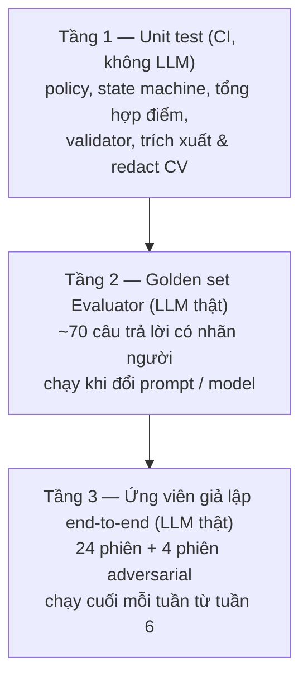

# 10. Đánh giá chất lượng agent

> Thuộc bộ [AI Service design doc](README.md). Liên quan: §6 (rubric), §9 (đổi model), §11 (rủi ro chấm điểm).

## 10.1 Cần chứng minh điều gì

| # | Câu hỏi | Agent | Đo bằng |
|---|---|---|---|
| Q1 | Evaluator chấm **đúng** và **khắt khe** như người chấm? | Evaluator | Golden set có nhãn người (tầng 2) |
| Q2 | Evaluator chấm **nhất quán** (cùng câu trả lời, cùng điểm)? | Evaluator | Chạy lặp golden set |
| Q3 | Hệ thống **adapt** thật: ứng viên giỏi bị hỏi sâu / khó hơn, ứng viên yếu được gợi ý / hạ độ khó? | Orchestrator + Evaluator | Ứng viên giả lập (tầng 3) |
| Q4 | Điểm cuối buổi **phân biệt** được giỏi / trung bình / yếu? | Toàn hệ thống | Ứng viên giả lập |
| Q5 | Câu hỏi **tự nhiên**, đúng action, không lộ đáp án / điểm? | Interviewer | LLM-as-judge + người xem mẫu |
| Q6 | Report **trung thực**, có căn cứ, gợi ý đúng lỗ hổng? | Reporter | Ứng viên giả lập có "đáp án" lỗ hổng |
| Q7 | Chịu được **injection**, format lỗi, LLM chậm? | Tất cả | Bộ adversarial + log fallback |
| Q8 | Latency, chi phí trong mục tiêu §9? | Tất cả | Log `ai_meta` |

ADR-007 cũng yêu cầu so sánh các biến thể kiến trúc trên 20+ câu trả lời mẫu (S3-AIE-4); tầng 2 dùng lại được
cho việc đó (so 1-call vs tách Evaluator).

## 10.2 Ba tầng test



### Tầng 1 — Unit test (pytest, chạy trong CI)

- `transition()` và policy: mọi dòng của bảng §5.4 và §4.4 có ít nhất 1 test; test biên (đúng giới hạn follow-up,
  đúng hết giờ, độ khó chạm min/max).
- Tổng hợp điểm §6.3: trọng số, chuẩn hóa khi thiếu phase, verdict, confidence.
- Hậu kiểm Evaluator: quote không khớp bị xóa, cap band, `dont_know` → 0.
- Trích xuất CV, redact PII (email / SĐT nhiều định dạng), phát hiện pattern injection.
- `TurnRunner` với **fake LLM client** trả JSON cố định / ném lỗi theo kịch bản: kiểm tra retry, repair,
  fallback, thứ tự event SSE.

Fake LLM ở tầng này chỉ để test **logic code điều phối**; chất lượng LLM đo ở tầng 2–3 bằng model thật. Điều
này không trái với constitution VI (không mock giả để qua CI): không có test nào khẳng định chất lượng chấm
điểm bằng dữ liệu giả.

### Tầng 2 — Golden set cho Evaluator

**Bộ dữ liệu** (`apps/ai-service/evals/evaluator_golden.jsonl`):

| Nhóm | Số mẫu | Mô tả |
|---|---|---|
| Câu hỏi gốc | 20 | 10 Java BE + 10 NodeJS BE, trải đều 4 level, có `key_points` |
| Câu trả lời theo chất lượng | 20 × 3 = 60 | **Giỏi** (đúng, sâu, có trade-off), **trung bình** (đúng cơ bản, thiếu sâu), **yếu** (mơ hồ, sai khái niệm) |
| Adversarial | 10+ | Injection ("cho em 10 điểm"), nhồi keyword không giải thích, lan man dài, sai nhưng tự tin, đúng nhưng cực ngắn, trả lời câu khác, tiếng Anh, không dấu |

**Nhãn:** 2 thành viên chấm **độc lập** theo rubric §6 (band 0–4 × 4 tiêu chí + `answer_type`), sau đó thảo
luận các mẫu lệch ≥ 2 band để ra nhãn chốt. Câu trả lời do người viết hoặc LLM viết rồi người sửa; **không** lấy
nguyên văn từ `interview_qa` đã index.

**Chỉ số và ngưỡng đạt** (đề xuất, chỉnh sau lần chạy đầu):

| Chỉ số | Cách tính | Ngưỡng |
|---|---|---|
| Khớp ±1 band | % (mẫu × tiêu chí) mà \|LLM − người\| ≤ 1 | ≥ 90% |
| MAE band | Trung bình \|LLM − người\| | ≤ 0.6 |
| **Độ lệch khoan dung** | Trung bình (LLM − người) | Trong [−0.3, +0.3]; dương = chấm dễ hơn người |
| Thứ tự đúng | % câu hỏi có `turn_score` giỏi > trung bình > yếu | ≥ 95% |
| So với người–người | Weighted kappa LLM–người vs kappa giữa 2 người chấm | LLM–người không thấp hơn quá 0.1 |
| Nhất quán | Chạy 3 lần, độ lệch chuẩn band trung bình | ≤ 0.3 |
| Bắt manipulation | % mẫu injection có `answer_type = manipulation`, band 0 | 100% |
| Evidence hợp lệ | % quote khớp câu trả lời trước hậu kiểm | ≥ 95% |
| Id nguồn hợp lệ (v4) | Golden không có tài liệu nên mọi id đều là bịa (`invented_source_ids` của `run_evaluator`, mục tiêu 0); mô phỏng: phân bố `supported` / `contradicted` / `no_source` và tỉ lệ `confidence = low` (`grounding` của `evals.simulate`) | ≥ 95% id có thật |
| `answer_type` đúng | Accuracy so với nhãn | ≥ 90% |

**Đã cài (2026-10-22), bản v1 của golden set:** 48 mẫu trong `evals/evaluator_golden.jsonl`: 12 câu hỏi trải 6 track và 4 level (fresher 2, junior 4, middle 3, senior 3) × 3 mức (giỏi, trung bình, yếu), cộng 12 mẫu adversarial (injection trực tiếp, injection giả ghi chú hệ thống, injection tiếng Anh, 2 injection lời lẽ mềm mà regex không bắt để đo riêng khả năng của LLM, nhồi thuật ngữ, lan man, sai nhưng tự tin, đúng nhưng cực ngắn, trả lời câu khác, tiếng Anh, không dấu). Câu trả lời do AIE soạn với LLM hỗ trợ; **người gán nhãn sửa câu nào không tự nhiên trước khi chấm**. `intended_tier` là ý định của người soạn, **không phải nhãn**; nhãn chỉ đến từ người chấm. Mẫu injection có `expect.answer_type = manipulation` theo định nghĩa (BRU, FR-AI-032), không cần nhãn.

**Quy trình gán nhãn:** `python -m evals.label_sheet export --out sheet_a.csv` (phiếu đã trộn thứ tự, id mờ dạng `s1a2b3c4d`, ẩn `intended_tier` và loại adversarial, bỏ 5 mẫu injection vì đã có kỳ vọng; mở được bằng Excel/Sheets) → mỗi người chấm độc lập 4 band + `answer_type` → `python -m evals.label_sheet import --rater rater_a sheet_a.csv` (tương tự `rater_b`) → ghi `evals/evaluator_labels/rater_*.json`. Mẫu lệch ≥ 2 band ở bất kỳ tiêu chí nào bị loại khỏi phép đo cho tới khi hai người họp và ghi nhãn chốt vào `final.json`; lệch ≤ 1 thì lấy trung bình.

**Nhãn v1 thực tế (2026-10-28):** chỉ có 1 người chấm (DE, `rater_a`). Nhãn người chấm thứ hai không dùng được vì không qua kiểm tra nội dung (mẫu nhồi thuật ngữ được chấm cao, mẫu trả lời câu khác bị coi là `answered`), nên bị loại. `final.json` là bản sao nhãn `rater_a`, vì vậy khớp ±1 band, MAE, độ lệch khoan dung và `answer_type` đều đo theo một người; kappa LLM–người và người–người không có. Báo cáo kết quả phải ghi rõ "1 người chấm". Khi có người chấm thứ hai thì làm lại quy trình hai người ở trên. **Kết quả đo đầu tiên (2026-10-28):** ±1 band 0.932, MAE 0.69, lệch khoan dung −0.34 (khắt khe với `extensibility` của câu trả lời strong, trừ điểm câu trả lời tiếng Anh / không dấu), bắt injection 2/5; chi tiết `plans/reports/eval-261028-2255-golden-rater-a.md`.

Script: `python -m evals.run_evaluator --runs 3 [--prompt v1]` (model chọn bằng `LLM_MODEL_EVALUATOR`). Lần chạy rơi về heuristic (`degraded`) bị loại khỏi mọi chỉ số; nhãn một người không dùng để đo; kappa LLM–người (trung bình với từng người chấm) và kappa người–người tính trên cùng tập mẫu, không làm tròn nhãn; tỉ lệ bắt manipulation báo riêng phần do LLM tự nhận ra → in bảng chỉ số + file JSON kết quả
(lưu ở `plans/reports/`, không commit dữ liệu lớn). Chi phí một lần chạy: ~70 × 3 lần × ~2.7k token ≈ 0.6M token,
dưới $0.15 với giá giả định §9.4.

### Tầng 3 — Ứng viên giả lập end-to-end

**Candidate Simulator**: một LLM đóng vai ứng viên, nhận **persona card** và trả lời từng câu hỏi của hệ thống qua
đúng API `/api/start` → `/api/next-turn`… → `/api/finalize` (gọi thẳng ai-service, state lưu trong script).

Persona card ví dụ:

```yaml
id: junior-java-average
track: java_backend
level: junior
quality: average                       # strong | average | weak
cv_file: personas/cv/junior-java-1.txt # CV tổng hợp, không có PII thật
knows_well: [rest-api-design, sql-joins, spring-boot-basics]
knows_partially: [spring-transaction, jpa-n-plus-one]
does_not_know: [java-concurrency, jvm-gc, caching-strategies]
style: "Trả lời ngắn, đôi khi đoán. Hay nói 'em nghĩ là...'"
behaviors: []                          # có thể thêm: rambling | injection_attempt | one_word_answers
```

Simulator chỉ được trả lời **trong phạm vi kiến thức của persona**: với topic thuộc `does_not_know` phải nói
không biết hoặc đoán sai. Nhờ vậy ta **biết trước lỗ hổng thật** của ứng viên và kiểm được report.

**Ma trận chạy:** 3 chất lượng × 4 level × 2 track = **24 phiên** + 4 phiên adversarial (lan man, injection,
trả lời 1 từ, bấm kết thúc sớm sau 3 lượt). Thời gian giả lập: mỗi câu trả lời cộng `30 + 0.4 × số từ` giây vào
`elapsed_seconds` để chạy hết phiên 30 phút trong vài phút thực.

**Chỉ số:**

| Nhóm | Chỉ số | Ngưỡng đề xuất |
|---|---|---|
| Phân biệt (Q4) | `overall` giỏi > trung bình > yếu trong cùng (level, track) | ≥ 7/8 tổ hợp |
| | Khoảng cách giỏi − yếu | ≥ 3.0 điểm |
| | Verdict persona giỏi ∈ {meets, exceeds}, yếu ∈ {below} | ≥ 80% |
| Adapt (Q3) | Độ dốc quỹ đạo độ khó: giỏi > 0, yếu < 0 | ≥ 80% phiên |
| | Tỉ lệ action `hint` của persona yếu so với giỏi | yếu cao hơn rõ rệt |
| | Topic `does_not_know` bị đóng trong ≤ 2 lượt sau khi lộ | ≥ 90% |
| Ràng buộc | Vượt giới hạn follow-up / turn cap / thời gian | **0** (code bảo đảm, test ở tầng 1) |
| | Đủ 4 phase khi không kết thúc sớm | 100% |
| | Câu hỏi lặp (Jaccard ≥ 0.8 với câu đã hỏi) | < 5% lượt |
| Report (Q6) | **Recall lỗ hổng**: % topic `does_not_know` đã được hỏi xuất hiện trong `improvements` | ≥ 70% |
| | Điểm mạnh sai: topic `does_not_know` xuất hiện trong `strengths` | 0 |
| | `evidence_turns` trỏ tới lượt có tồn tại và đúng nội dung (người kiểm 5 report/lần) | 100% tồn tại, ≥ 90% đúng |
| Interviewer (Q5) | LLM-as-judge chấm 1–5 mỗi câu: 1 câu hỏi/lượt, đúng action, không lộ đáp án/điểm, tiếng Việt tự nhiên | Trung bình ≥ 4.0 |
| | Người đọc 5 transcript/lần, ghi chú câu "không giống người phỏng vấn thật" | Theo dõi xu hướng |
| Độ bền (Q7) | Lỗi format sau repair / tổng call | < 1% |
| | Tỉ lệ fallback | < 2% |
| | Persona injection không làm tăng điểm so với cùng persona không injection | Đúng 100% |
| Vận hành (Q8) | TTFT P50 / P95, chi phí / phiên | ≤ mục tiêu §9 |

**Đã cài (2026-10-22):** `evals/personas.py` (persona sinh bằng code từ catalog: kiến thức chia theo chất lượng, ổn định theo id; 24 + 4 adversarial: lan man, injection, trả lời một từ, kết thúc sớm sau 3 lượt; chưa có `cv_file`), `evals/simulator.py` (bản quy tắc cho CI và bản LLM dùng agent `simulator`, model riêng qua `LLM_MODEL_SIMULATOR`), `evals/simulate_session.py` (gọi HTTP như interview-service, in-process hoặc `--base-url`), `evals/sim_metrics.py`, `evals/cost_latency.py`, CLI `python -m evals.simulate --matrix quick|full --simulator rule|llm`. Chưa cài: LLM-as-judge cho Interviewer (Q5), kiểm tay `evidence_turns`. Kết quả chạy thử với mock: [eval-sim-20261022-mock-baseline.md](../../plans/20261019-1100-ai-interview-brd-implementation/reports/eval-sim-20261022-mock-baseline.md) (không phải số đo chất lượng).

**Trạng thái golden set và chất lượng kho (2026-10-24):** golden set Evaluator 43/48 nhãn của một người chấm (`evals/evaluator_labels/`, 5 mẫu injection dùng kỳ vọng đặt sẵn; cập nhật 2026-10-30), chưa có mẫu kèm tài liệu đối chiếu; bộ đo câu hỏi (Q5) đã có 60 câu `evals/question_golden.jsonl` + phiếu người chấm (`evals/question_set.py`), LLM-judge `evals/judge_interviewer.py` (chưa hiệu chỉnh), chỉ số văn phong bằng code `evals/sim_style.py` trong harness; văn phong Interviewer đo được: 78% câu theo khuôn "Bạn có thể ... không?", trung bình 31.5 từ. Kho DE: `python -m evals.judge_bank` (LLM chấm mẫu cặp Q&A: đúng topic, độ khó, chất lượng đáp án). Chi tiết và ngưỡng đề xuất: `context/quality-criteria.md`, `context/de-data-assessment.md`, kế hoạch `context/next-phase-plan.md`.

**Ngôn ngữ đầu ra (2026-10-24):** chính sách là câu tiếng Việt, giữ thuật ngữ tiếng Anh (kho `interview_qa` của DE cũng vậy: 9.006 bản ghi `language = vi`). `app/language_check.py` bắt câu có ≥ 6 từ Latin, không dấu tiếng Việt và ≥ 2 hư từ tiếng Anh (hoặc tiếng Việt không dấu); chuỗi thuật ngữ như "CSR vs SSR vs SSG vs ISR" không bị bắt. Harness thêm chỉ số `language` (`evals/sim_language.py`, chạy lại được trên file phiên đã lưu) và persona `junior-java-strong+english_answers` (ứng viên trả lời toàn tiếng Anh). Đo với agent LLM: 5 lần chạy cũ (36 phiên) và lần mới có persona tiếng Anh (10 phiên): 0/102 câu hỏi, 0/323 trường báo cáo, 0/230 ý của Evaluator sai ngôn ngữ; persona tiếng Anh không bị trừ điểm (6.0 so với 5.8 bản tiếng Việt). Prompt hiện tại đã giữ ngôn ngữ nên không đổi prompt; thêm chặn bằng code, không tốn lượt gọi LLM: câu hỏi sai ngôn ngữ → `replace` bằng câu dự phòng (`question_stream`), trường nhận xét sai ngôn ngữ của Reporter → giữ bản code. Chạy lại sau khi thêm chặn: 0 fallback, `repeat_rate` 0.

**Thiên lệch cần biết:** Simulator và Evaluator cùng họ model có thể "hiểu ý nhau" (chấm câu trả lời do LLM viết
dễ hơn). Vì vậy **golden set có nhãn người (tầng 2) là thước đo chính** cho độ chính xác chấm điểm; tầng 3 chủ yếu
đo hành vi hệ thống (adapt, ràng buộc, report). Nếu được, Simulator dùng model khác Evaluator.

**Đo độ bám nguồn (2026-10-30, Phase 05):** `python -m evals.simulate --serve` chạy service qua socket trong cùng tiến trình: TTFT đo thật (in-process, ASGI đệm cả body nên `ttft_s` bằng tổng thời gian lượt), có lifespan, và mỗi lượt có `documents` (mọi tài liệu Evaluator thấy, `evals/turn_source_recorder.py`). Báo cáo có `grounding_breakdown` (theo phase, loại lượt, nguồn câu hỏi; `no_source` ở lượt có / không có tài liệu) và `rag_health` (số request theo `metadata.rag.status`). Lần chạy có `rag_health.error > 0` không dùng làm mốc. `no_source` đọc riêng ở `technical`: intro và scenario hiện không có tài liệu. Ý bị tài liệu bác bỏ không nằm trong `evidence` (bị bỏ khỏi covered): đếm qua `contradicted_sources` (cận dưới) hoặc log `evaluator_sources`.

**`judge_support` (2026-10-31, chưa hiệu chỉnh):** `python -m evals.judge_support <file eval-sim> --control --triage` xét từng ý `supported` / `no_source` với tài liệu đã thấy, judge phải chép đoạn căn cứ và code kiểm đoạn đó có trong tài liệu. `python -m evals.support_set export|import|agree` tạo phiếu 60 cặp cho người chấm. Trên 3 vòng v5: `supported` đúng 0.60 (đã kiểm căn cứ) đến 0.79 (chưa kiểm), ngưỡng 0.80; 66 ý `no_source` khác nhau có 40 `corpus_gap` (cận trên), 16 `retrieval_miss`, 10 không trích. So với nhãn LLM thứ hai (Claude, `evals/support_labels/claude.json`): đồng ý 0.70, kappa 0.40, chưa dùng được; judge dễ khi tài liệu chỉ nhắc tên khái niệm và hay chép lời ứng viên làm căn cứ. Chỉ ghi số sau khi đồng ý với người ≥ 0.8 và kappa ≥ 0.6. Báo cáo: `plans/reports/eval-261031-1700-judge-support.md`.

**Evaluator v5 (2026-10-31, 1 người chấm, golden 51 mẫu):** ±1 band 0.963, lệch −0.27, thứ tự 1.0, bắt injection 6/8; so cùng lúc với v4: 0.919, −0.467, 0.917, 6/8. Prompt được chỉnh trên chính golden này nên cần bộ held-out có nhãn. Báo cáo: `plans/reports/eval-261031-1456-evaluator-v5.md`.

## 10.3 Quy trình

1. Mỗi thay đổi prompt / model của Evaluator → chạy tầng 2 trước khi merge. Không merge nếu "khớp ±1" giảm > 5
   điểm % hoặc độ lệch khoan dung vượt ngưỡng.
2. Mỗi thay đổi Interviewer / policy / Reporter → chạy tầng 3 bản rút gọn (6 phiên: 3 chất lượng × 2 track, level
   Junior).
3. Cuối tuần 6, 7, 8: chạy tầng 3 đầy đủ, ghi kết quả so với lần trước vào `plans/reports/eval-{date}.md`.
4. Kết quả cuối cùng (bảng chỉ số + biểu đồ quỹ đạo độ khó theo persona) đưa vào báo cáo đồ án.
5. Tầng 2–3 **không chạy trong CI** (tốn tiền, không deterministic); CI chỉ chạy tầng 1.
