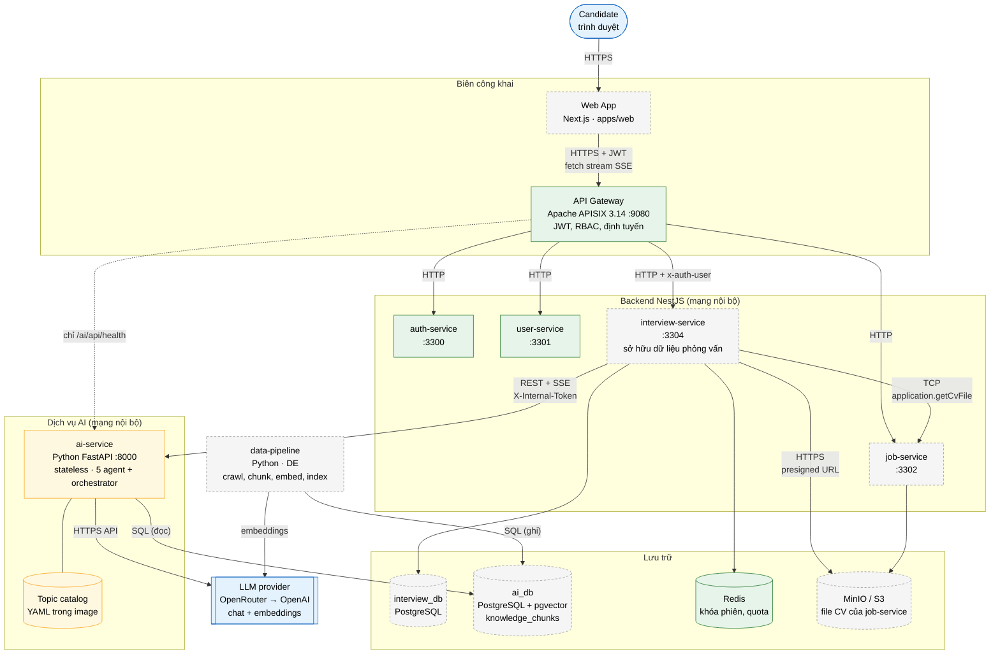
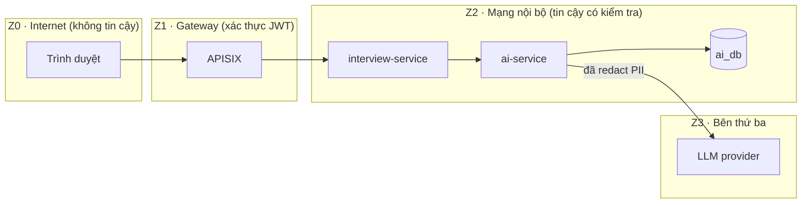
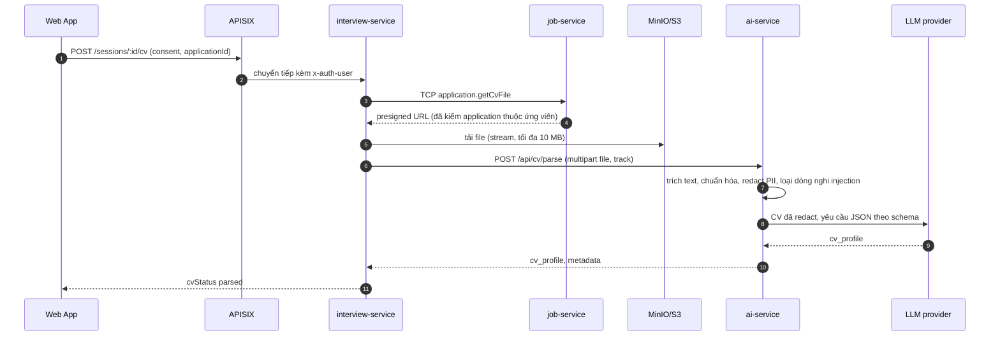
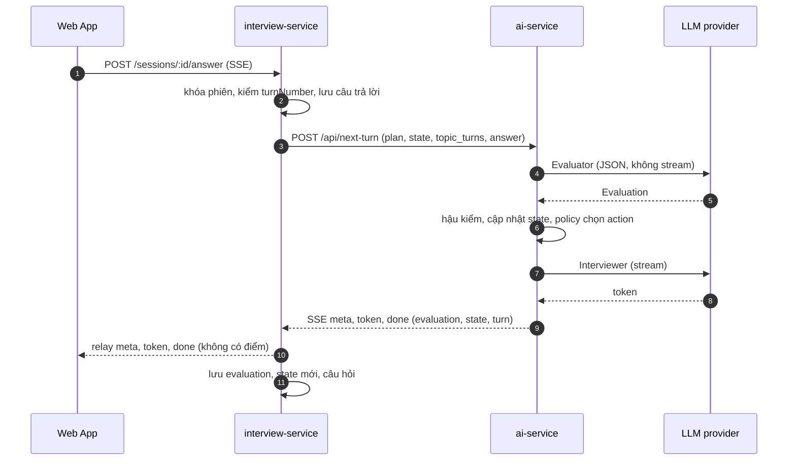
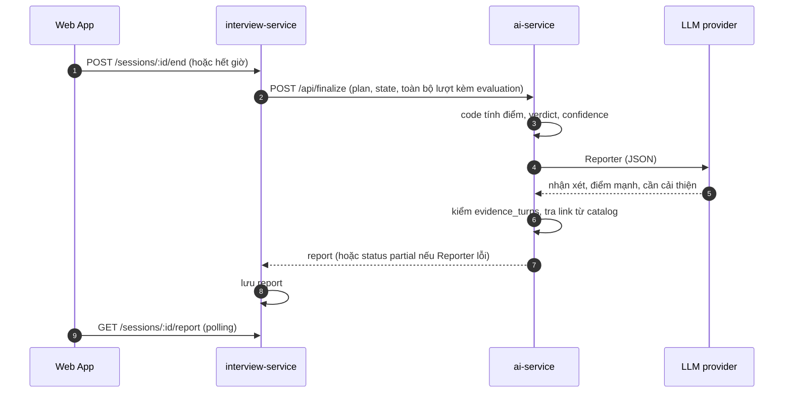
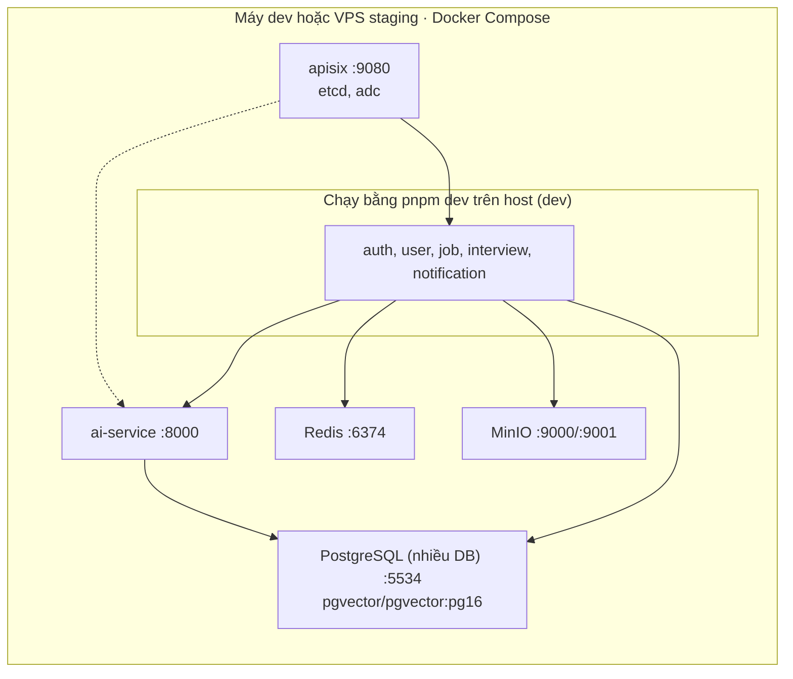

# 13. Kiến trúc L2 — Container (C4 Level 2)

> Thuộc bộ [AI Service design doc](README.md). Mô tả các **container** (đơn vị chạy và triển khai được) liên quan tới phần AIE, cách chúng giao tiếp, nơi lưu dữ liệu và ranh giới tin cậy. Yêu cầu nguồn: [BRD](requirements/01-brd.md) · [FR](requirements/02-functional-requirements.md) · [NFR](requirements/03-non-functional-requirements.md).

| Mục | Giá trị |
|---|---|
| Phiên bản | 0.1 (Draft, chờ team review) |
| Ngày | 2026-10-12 |
| Owner | AIE |
| Mức C4 | **Level 2 (Container)**. Level 1 (Context) tóm tắt ở §2; Level 3 (Component) của ai-service xem sơ lược ở §9 và chi tiết ở [02](02-multi-agent-architecture-and-prompts.md), [03](03-orchestrator-state-machine.md) |

> **Giả định về thuật ngữ:** "L2" được hiểu là C4 Level 2. Nếu nhóm dùng "L2" theo nghĩa khác (ví dụ tầng thứ hai của bộ tài liệu riêng), cần điều chỉnh.

> **Lưu ý (2026-10-12): tài liệu này viết theo BRD v0.1 (phỏng vấn chat văn bản, 15 đến 45 phút). [BRD v0.2](requirements/01-brd.md) đã mở rộng phạm vi sang hội thoại giọng nói và video thời gian thực 15 đến 20 phút, giao diện web, cho phép agent framework, fine-tune và học từ dữ liệu; nhận diện cảm xúc hoãn lại. Tài liệu này CHƯA được cập nhật theo v0.2. Phần bị ảnh hưởng: sơ đồ container (chưa có dịch vụ giọng nói, hạ tầng media, phần giao diện phòng phỏng vấn); luồng I1 và I4 (SSE văn bản qua REST); §8 các sequence diagram (đường nóng văn bản); §10 triển khai; nguyên tắc ai-service stateless và REST (có thể phải đổi vì hội thoại real-time cần kết nối bền). Nên trả lời các câu hỏi mở ở BRD mục 12 trước khi sửa.**

## 1. Cách đọc

- **Container** ở đây là thứ chạy độc lập: ứng dụng web, service, cơ sở dữ liệu, hàng đợi, hệ thống ngoài. Module hay class trong một service không xuất hiện ở mức này.
- **Hiện trạng trong repo** (nhánh `feat/aie`, `f1e61b2`, 2026-10-08) có ba trạng thái: **Có** (đã có code), **Mock** (đã có nhưng dùng quy tắc thay phần thật), **Kế hoạch** (chưa có trong repo).
- Mọi quyết định đã được ghi ở các ADR; tài liệu này chỉ liên kết, không lặp lại.

## 2. Ngữ cảnh hệ thống (C4 Level 1)

| Tác nhân hoặc hệ thống | Quan hệ với phần AI |
|---|---|
| **Candidate** | Chọn vị trí và level, trả lời câu hỏi, xem báo cáo |
| **Employer, Admin** | Không dùng trực tiếp tính năng này trong MVP |
| **LLM provider** (OpenRouter chuyển tiếp tới OpenAI) | Hệ thống ngoài. Nhận prompt và trả text, JSON, embedding |
| **Đội phát triển** (FSD, DE, AIE) | Soạn catalog, dữ liệu RAG, prompt; chạy bộ đánh giá |

## 3. Sơ đồ container

Chú giải màu: xanh lá = đã có trong repo; vàng = mock; xám nét đứt = kế hoạch, chưa có code; xanh dương = bên ngoài.

## 4. Danh mục container

| Container | Công nghệ | Trách nhiệm trong phạm vi phần AI | Chủ sở hữu | Hiện trạng |
|---|---|---|---|---|
| **Web App** | Next.js (`apps/web`, ADR-005) | Giao diện phỏng vấn: gửi câu trả lời, đọc stream SSE bằng `fetch`, trang báo cáo, trạng thái chờ | FSD | Kế hoạch |
| **API Gateway** | Apache APISIX 3.14 + etcd, ADC sync | Điểm vào công khai duy nhất; xác thực JWT; inject `x-auth-user`; định tuyến; chỉ cho `/ai/api/health` ra ngoài; không buffer SSE | DE | Có (route `/ai/*` thêm trong nhánh `feat/aie`, chưa kiểm chứng) |
| **auth-service** | NestJS | Đăng ký, đăng nhập, JWT | FSD | Có |
| **user-service** | NestJS | Hồ sơ người dùng | FSD | Có |
| **job-service** | NestJS | Tin tuyển dụng và **ứng tuyển, giữ file CV**; cung cấp TCP `application.getCvFile` kèm presigned URL | FSD | Kế hoạch |
| **interview-service** | NestJS | **Chủ sở hữu mọi dữ liệu phỏng vấn** (session, plan, candidate state, transcript, evaluation, report, `cv_profile`); điều phối gọi ai-service qua `AiInterviewClient`; relay SSE; khóa phiên và quota qua Redis; chống gửi trùng | FSD | Kế hoạch |
| **ai-service** | Python 3.11 hoặc 3.12, FastAPI, Pydantic v2, SDK `openai` | Thực hiện **toàn bộ logic AI không trạng thái**: CV Parser, Planner, Evaluator, Interviewer, Reporter; orchestrator, policy, tổng hợp điểm; truy xuất RAG; SSE | AIE | Mock |
| **Topic catalog** | YAML (`app/catalog/*.yaml`) | Danh sách chủ đề và tình huống theo vị trí; đóng gói cùng image ai-service | AIE + DE | Có (nội dung chưa review) |
| **interview_db** | PostgreSQL 16 | Dữ liệu phỏng vấn của interview-service | FSD | Kế hoạch |
| **ai_db** | PostgreSQL 16 + pgvector (`pgvector/pgvector:pg16`) | Bảng `knowledge_chunks` (`interview_qa`, `textbook`) | AIE (DDL) + DE (tạo DB, nạp dữ liệu) | Kế hoạch (DDL đã thiết kế, chưa chạy) |
| **Redis 8** | Redis | Khóa phiên `interview:lock:{sessionId}`, quota ngày; cache RAG (Sprint 4) | FSD (+ AIE cho cache) | Có trong compose |
| **MinIO / S3** | S3 API | Lưu file CV (một bản duy nhất, thuộc job-service) | DE / FSD | Kế hoạch |
| **data-pipeline** | Python | Crawl, chunk, dedup, embed, index vào `ai_db`; dùng chung module chunking và repository với ai-service | DE | Kế hoạch |
| **LLM provider** | OpenRouter → OpenAI (API OpenAI-compatible) | Sinh text và JSON; tạo embedding | Bên ngoài | Có (thử bằng smoke test) |

## 5. Giao tiếp giữa các container

| # | Từ | Tới | Giao thức | Mục đích | Xác thực | Timeout / ghi chú |
|---|---|---|---|---|---|---|
| I1 | Web App | API Gateway | HTTPS, JSON và SSE qua `fetch` | Mọi lời gọi của ứng viên | JWT | `EventSource` không dùng được vì cần header `Authorization` và POST (D06 §7.5) |
| I2 | API Gateway | interview-service | HTTP | Định tuyến `/interview/*` | Gateway verify JWT, inject `x-auth-user` | `timeout.read` upstream ≥ 60 s cho SSE |
| I3 | API Gateway | ai-service | HTTP | **Chỉ** `GET /ai/api/health` | Công khai | Route còn lại yêu cầu JWT trong cấu hình hiện tại; mục tiêu là chặn hẳn (SEC01) |
| I4 | interview-service | ai-service | REST/HTTP, SSE | `cv/parse`, `start`, `next-turn`, `finalize`, `health` | Header `X-Internal-Token` (chưa làm) | 30 s, 40 s, 45 s, 90 s, 5 s (D06 §7.4); snake_case ở biên, ánh xạ camelCase làm ở client |
| I5 | interview-service | job-service | NestJS TCP | `application.getCvFile`: kiểm tra application thuộc ứng viên, trả presigned URL | Nội bộ | Kiểm quyền sở hữu là bắt buộc (D10 P9) |
| I6 | interview-service | MinIO / S3 | HTTPS, presigned URL | Tải file CV, stream, tối đa 10 MB, không ghi đĩa | URL có hạn 5 phút | |
| I7 | interview-service | interview_db | SQL (MikroORM) | Lưu và đọc dữ liệu phiên | | State có `state_version` để khóa lạc quan |
| I8 | interview-service | Redis | Redis protocol | Khóa phiên TTL 60 s, quota ngày | | |
| I9 | ai-service | ai_db | SQL (SQLAlchemy, pgvector) | **Đọc** `knowledge_chunks` | Tài khoản chỉ đọc (đề xuất) | Chỉ ai-service và pipeline đụng `ai_db` |
| I10 | ai-service | LLM provider | HTTPS | Chat completions, embeddings | API key trong biến môi trường | Retry tối đa 2 lần; ngân sách thời gian theo agent (D08 §9.3) |
| I11 | data-pipeline | ai_db | SQL | **Ghi** chunk, upsert theo `content_hash` | Tài khoản ghi | Idempotent (CON V) |
| I12 | data-pipeline | LLM provider | HTTPS | Embedding khi index | API key | |

Quy tắc ràng buộc (constitution): service **không** truy vấn hay ghi DB của service khác (I); NestJS ↔ NestJS dùng TCP, NestJS ↔ ai-service dùng REST (II); contract đổi thì cập nhật tài liệu cùng PR (III); ai-service stateless và chỉ sở hữu `knowledge_chunks` (IV).

## 6. Dữ liệu và quyền sở hữu

| Dữ liệu | Nơi lưu | Chủ sở hữu | ai-service đọc/ghi |
|---|---|---|---|
| Session, transcript, evaluation từng lượt, report | `interview_db` | interview-service | Nhận qua request, trả qua response; **không lưu** |
| `cv_profile` (đã bỏ liên hệ), `cv_file_ref` | `interview_db` | interview-service | Tạo ra (CV Parser) rồi trả về |
| Plan và candidate state | `interview_db` (JSONB) | interview-service | Nhận trong request, trả bản mới trong `done` |
| **File CV gốc** | MinIO / S3 | job-service | Chỉ thấy bytes trong một request `cv/parse`, không lưu |
| Knowledge base (`interview_qa`, `textbook`) | `ai_db.knowledge_chunks` | ai-service (schema), pipeline (nội dung) | Đọc |
| Topic catalog | File YAML trong repo, đóng gói trong image | AIE + DE | Đọc lúc chạy |
| Prompt | File trong repo (`app/prompts/*.md`) | AIE | Đọc lúc chạy |
| Khóa phiên, quota | Redis | interview-service | Không |
| Token, độ trễ, phiên bản prompt, fallback | `ai_meta` JSONB trong `interview_db` | interview-service | Tạo `metadata` trong response |
| Dữ liệu phiên trong ai-service | **Không có** | | Log chỉ chứa id và số đo |

Ranh giới quan trọng: transcript, câu trả lời, `cv_profile` và file CV **không bao giờ** đi vào `knowledge_chunks` hay dữ liệu pipeline (cần amendment constitution V).

## 7. Ranh giới tin cậy

| Ranh giới | Rủi ro | Biện pháp (liên kết NFR) |
|---|---|---|
| Z0 → Z1 | Truy cập trái phép, lạm dụng | JWT tại gateway, RBAC; quota ngày (SEC09) |
| Z1 → Z2 | Gọi thẳng ai-service để đốt chi phí | Chỉ expose `/ai/api/health`; `X-Internal-Token` (SEC01) |
| Nội dung ứng viên → agent | **Prompt injection** từ CV và câu trả lời | CV thô chỉ CV Parser thấy; khối `untrusted`; hậu kiểm bằng code; band ép 0 với `manipulation` (SEC02, SEC03) |
| Nội dung RAG → agent | Chỉ dẫn nhúng trong tài liệu web | Đặt trong khối phân cách, dặn model chỉ tham khảo (rag-design §5) |
| Z2 → Z3 | Lộ dữ liệu cá nhân tới bên thứ ba | Redact PII trước LLM; không log nội dung; consent riêng; provider không lưu dữ liệu nếu có (PRIV01, PRIV03, PRIV05, PRIV07) |
| Dữ liệu phiên → kho tri thức | Rò rỉ chéo ứng viên | Cấm ghi dữ liệu phiên vào `knowledge_chunks` (PRIV04) |

## 8. Luồng chạy chính

### 8.1 Gắn CV (tùy chọn)

### 8.2 Một lượt phỏng vấn (đường nóng)

Độ trễ đường nóng gồm hai lời gọi LLM nối tiếp (Evaluator rồi Interviewer); chỉ tiêu và rủi ro ở NFR-AI-PERF01. Trường hợp `dont_know` bỏ qua Evaluator.

### 8.3 Kết thúc và báo cáo

## 9. Bên trong ai-service (xem trước Level 3)

| Thành phần mục tiêu | Trách nhiệm | File hiện có trong mock (`apps/ai-service/app/`) |
|---|---|---|
| API layer | Route, validate Pydantic, SSE, format lỗi | `main.py`, `sse.py`, `api_error.py`, `models_*.py` |
| Orchestrator (state machine) | Điều phối một lượt: chấm, cập nhật state, policy, hỏi | `turn_engine.py` |
| Policy | Chọn action theo bảng luật | `policy.py` |
| Agent: CV Parser | Trích `cv_profile` | `mock_cv_parser.py` + `cv_text.py` (phần trích text, redact, injection là code thật) |
| Agent: Planner | Sinh plan từ catalog | `mock_planner.py` |
| Agent: Evaluator | Chấm band, bằng chứng | `mock_evaluator.py` |
| Agent: Interviewer | Diễn đạt câu hỏi, stream | `mock_interviewer.py` |
| Agent: Reporter + scoring | Tổng hợp điểm (code) + nhận xét | `report_scoring.py` |
| Topic catalog loader | Đọc YAML, kiểm schema | `catalog/` |
| LLM client | Client OpenAI-compatible, retry, repair, đo usage | `llm_client.py`, `config.py` (chưa có retry hay repair) |
| RAG module | Embedding, truy xuất, repository, chunking | **Chưa có** (`app/rag/` theo rag-design §6) |
| Prompt store | Prompt có phiên bản | **Chưa có** (`app/prompts/`) |

Hiện các file `mock_*` dùng quy tắc thay LLM; khi có LLM thật chỉ thay phần thân agent, giữ nguyên interface và orchestrator.

## 10. Triển khai

| Hạng mục | Giá trị hiện tại | Ghi chú |
|---|---|---|
| Đóng gói ai-service | `apps/ai-service/Dockerfile`, `python:3.12-slim`, `uvicorn app.main:app` cổng 8000, healthcheck `curl /api/health` | Catalog YAML nằm trong image; chưa build lại với thư viện CV mới |
| Tên container, network | `nest_turbo_*`, `nest-turbo-network` trong nhánh này | Nhánh `chore/rename-project-scope` (DE) đổi sang `ai_recruit_*` và `ai-recruit-network`; khối `ai-service` phải đổi theo sau khi nhánh đó merge |
| Biến môi trường ai-service | `LLM_API_KEY`, `LLM_BASE_URL`, `LLM_MODEL`, `EMBEDDING_MODEL`, `EMBEDDING_DIMENSIONS`, `LLM_TIMEOUT_SECONDS`, `MOCK_STREAM_DELAY_MS` | Cần thêm: `X-Internal-Token`, model theo từng agent, `LOG_LLM_IO`, kết nối `ai_db` |
| Gateway | Route `/ai/*` trong `config/apisix/conf/apisix-dev.yaml`; chỉ `/ai/api/health` công khai | Chưa kiểm chứng SSE qua gateway |
| Scale | Thêm instance ai-service sau gateway hoặc load balancer; không cần sticky session vì stateless | Quy mô demo khoảng 20 phiên đồng thời |
| Staging | Docker Compose trên VPS hoặc cloud có HTTPS | Thuộc DE (feature 014) |

## 11. Chiến thuật kiến trúc cho thuộc tính chất lượng

| Thuộc tính | Chiến thuật | NFR |
|---|---|---|
| Hiệu năng | Evaluator output gọn (`max_tokens` 350), RAG lấy trước một lần lúc plan, bỏ qua Evaluator khi `dont_know`, client HTTP dùng chung, stream câu hỏi, bất đồng bộ I/O | PERF01..09 |
| Khả năng mở rộng | Stateless, thêm process ngang, catalog dạng dữ liệu | SCAL01..04 |
| Độ tin cậy | Retry giới hạn, repair, fallback theo agent, bảng xử lý lỗi, giới hạn cứng bằng code, interview-service đọc hết stream | REL01..09 |
| Độ chính xác chấm | Rubric theo level, luật khắt khe áp bằng prompt **và** code, hậu kiểm quote, điểm do code tổng hợp, tách Evaluator khỏi Interviewer | QUAL01..15 |
| Bảo mật | Gateway duy nhất, `X-Internal-Token`, cô lập CV thô, khối untrusted, validate input | SEC01..09 |
| Quyền riêng tư | Redact trước LLM, không log nội dung, consent riêng, cấm dữ liệu phiên vào kho tri thức | PRIV01..08 |
| Chi phí | Model nhỏ cho đường nóng, ghi usage mọi lời gọi, cảnh báo ngưỡng, quota ngày | COST01..05 |
| Bảo trì | Policy và scoring là code thuần nên unit test được; prompt có phiên bản; catalog tách khỏi code; file nhỏ | MNT01..08 |

## 12. Quyết định kiến trúc liên quan

| ADR / nguồn | Nội dung | Ảnh hưởng tới L2 |
|---|---|---|
| ADR-001 | APISIX thay Kong | Gateway duy nhất |
| ADR-002 | Database-per-service | `interview_db` và `ai_db` tách |
| ADR-003 | TCP giữa NestJS, REST với ai-service | I4, I5 |
| ADR-004 | interview-service sở hữu dữ liệu phỏng vấn, ai-service stateless | §6 |
| ADR-005 | Frontend trong monorepo | Web App |
| ADR-006 | Gộp application vào job-service | I5 (CV lấy từ job-service) |
| **ADR-008** | Evaluator mỗi lượt, Planner một lần, orchestrator bằng code | §9 |
| Constitution IV, V | AI stateless; pipeline tái lập, không dữ liệu cá nhân vào kho | §6, §7; cần amendment vì ADR-008 đổi nội dung contract |

## 13. Khoảng cách giữa mục tiêu và hiện trạng

| # | Hạng mục | Mục tiêu | Hiện trạng | Việc cần làm |
|---|---|---|---|---|
| G1 | Agent LLM | 5 agent gọi LLM thật | Mock bằng quy tắc | FR-AI-013, 020, 030, 037, 052 |
| G2 | Truy xuất RAG | `ai_db` + `app/rag/` | Chưa có DDL chạy, chưa có module | FR-AI-060..062, cần DE (T016) |
| G3 | Độ bền | Retry, repair, fallback đầy đủ | Chưa | FR-AI-070..072 |
| G4 | Bảo vệ route | `X-Internal-Token`, chặn `/ai/*` | Route có, token chưa | FR-AI-091 |
| G5 | `interview-service` | Có, quản lý phiên và relay SSE | Chưa tồn tại | FSD, cần duyệt contract |
| G6 | `job-service` | `application.getCvFile` | Chưa tồn tại | FSD; thiếu thì phỏng vấn không CV |
| G7 | Streaming qua gateway | Không buffer | Chưa kiểm chứng | Spike tuần 4 (CMP04) |
| G8 | Tên container | `ai_recruit_*` | `nest_turbo_*` | Chờ nhánh rename merge rồi sửa khối ai-service |
| G9 | Python | Một phiên bản (CI 3.11 dự kiến) | 3.12 ở Docker, 3.9 máy dev | Chốt một phiên bản (CMP03) |
| G10 | Constitution | Amendment IV, V | Constitution đang Proposed | Cả team duyệt |
| G11 | Image Docker | Build với thư viện CV mới | Chưa build lại | Build khi Docker chạy |

## 14. Câu hỏi mở

1. `ai-service` đọc `ai_db` qua tài khoản chỉ đọc riêng, hay dùng chung tài khoản với pipeline? (Đề xuất: tách.)
2. DDL `knowledge_chunks` đặt trong `scripts/init-databases.sh` (constitution I) hay có migration riêng cho `ai_db`?
3. `X-Internal-Token` cấp phát và xoay vòng thế nào giữa interview-service và ai-service?
4. Cache RAG (Redis, TTL 1 giờ, Sprint 4) đặt ở ai-service hay ở interview-service? Hiện thiết kế ghi ai-service nhưng ai-service chưa kết nối Redis.
5. Relay SSE trong interview-service có chịu được nén (compression middleware) và timeout của APISIX không? (D06 §7.5)
